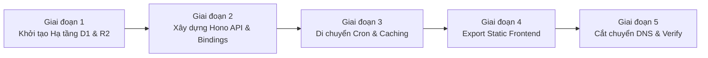

# VIETFI ADVISOR — TARGET ARCHITECTURE: CLOUDFLARE-NATIVE
**Tài liệu Thiết kế Kiến trúc Chuẩn (SSOT Architecture Specification)**  
**Phiên bản:** 1.0.0  
**Tác giả:** Agent 05 — Cloudflare Architecture Architect  
**Trạng thái:** Proposed / Target Architecture Baseline  
**Hệ sinh thái:** Cloudflare Workers, Hono, D1, KV, R2, AI Gateway, Cron Triggers, Static Assets  
**Cloudflare Profile:** `main` (`ppnh10092002@gmail.com` | Account ID: `5fdd1d1433519df6429d7418d43fff9a` | CLI: `cf-main`)

---

## 1. Executive Summary & Động Lực Dịch Chuyển (Architectural Drivers)

### 1.1. Bối cảnh & Điểm nghẽn kiến trúc hiện tại (Vercel + Supabase)
Dự án VietFi Advisor là nền tảng quản lý tài chính cá nhân & cố vấn thông minh hỗ trợ bởi AI (linh vật Vẹt Vàng) cho người Việt. Hiện tại, hệ thống đang vận hành theo mô hình:
- **Hosting:** Vercel Hobby / Node.js Standalone.
- **Hạn chế Vercel Cron:** Gói Vercel Hobby giới hạn **1 cron job/ngày** và thời gian thực thi tối đa **10 giây**. Đội ngũ phải dựng giải pháp chắp vá dùng GitHub Actions gọi ngược webhook vào API.
- **Độ trễ Mạng (Latency):** Máy chủ serverless đặt tại các cụm khu vực (Singapore/US) dẫn đến Round-Trip Time (RTT) khi người dùng từ Việt Nam truy vấn dữ liệu tài chính (VN-Index, Vàng SJC, Tỷ giá USD/VND) thường dao động từ 150ms - 350ms.
- **Database ngoài vùng:** Supabase PostgreSQL kết nối qua TCP/Pooler có độ trễ cold-start và chi phí duy trì khi phình to dữ liệu nến EOD (`daily_ohlcv`).
- **AI Direct Calling:** Gọi trực tiếp Google Gemini API không qua Gateway dẫn đến thiếu bộ đệm Semantic Cache cho các prompt tài chính lặp lại và dễ chạm rate limit đột ngột.

### 1.2. Mục tiêu kiến trúc Cloudflare-Native 100%
Dịch chuyển toàn diện VietFi Advisor sang kiến trúc **Cloudflare-Native Edge-First**:
1. **Zero Cold-Start & Siêu tốc tại Việt Nam:** Tận dụng 2 Point of Presence (PoP) Cloudflare tại **Hà Nội (HAN)** và **TP. Hồ Chí Minh (SGN)**. TTFB (Time to First Byte) cho API và Static Assets giảm xuống **< 30ms**.
2. **Chi phí 0 VNĐ (Tối ưu hóa 100% Free Tier):**
   - Cloudflare Workers: 100,000 requests/ngày (hoặc 300,000 req/ngày trên profile phân lập).
   - Cloudflare D1: 5,000,000 rows read/ngày, 100,000 rows write/ngày, 10GB dung lượng.
   - Cloudflare KV: 100,000 reads/ngày, 1,000 writes/ngày.
   - Cloudflare R2: 10GB lưu trữ miễn phí, **0đ chi phí băng thông tải về (Zero Egress Fees)**.
   - Cloudflare Cron Triggers: Miễn phí, hỗ trợ tần suất kích hoạt từng phút (không bị giới hạn 1 lần/ngày như Vercel).
3. **Tuân thủ chuẩn CLI-First & 3 Profile Cloudflare:** Quản trị tuyệt đối qua `wrangler` CLI và PowerShell scripts, định danh theo Profile `main` (Account `5fdd1d1433519df6429d7418d43fff9a`).

---

## 2. Sơ Đồ Kiến Trúc Hệ Thống (System Architecture)

### 2.1. Sơ đồ luồng dữ liệu ASCII (ASCII Architecture Flow)

```text
+--------------------------------------------------------------------------------------------------+
|                                    NGƯỜI DÙNG / TRÌNH DUYỆT (VN)                                |
|  [PWA Client: React 19 / Tailwind / TanStack Query / IndexedDB / LocalStorage / LightweightCharts] |
+--------------------------------------------------------------------------------------------------+
                                        │                           ▲
                 1. Static Assets (GET) │                           │ 2. Edge API Response
                 HTTP Requests (/api/*) ▼                           │    (Streaming SSE / JSON)
+──────────────────────────────────────────────────────────────────────────────────────────────────+
|                                  CLOUDFLARE EDGE NETWORK (HAN / SGN)                             |
|                                                                                                  |
|  ┌──────────────────────────────────────────────┐  ┌──────────────────────────────────────────┐  |
|  │          Cloudflare Static Assets            │  │     Cloudflare Workers (Hono Router)     │  |
|  │      (Next.js Static Export / out/)          │  │  - CORS / SecurityHeaders / RateLimiter │  |
|  │  - index.html, dashboard.html, *.js, *.css   │  │  - JWT Auth / Guest DAL Adapter          │  |
|  │  - Lottie JSON, Icons, Manifest PWA          │  │  - API Routes: /chat, /market, /screener │  |
|  └──────────────────────────────────────────────┘  └─────────────────────┬────────────────────┘  |
|                                                                          │                       |
|           ┌──────────────────────────────────────────────────────────────┼─────────────────┐     |
|           ▼                                                              ▼                 ▼     |
|  ┌──────────────────┐  ┌──────────────────┐  ┌─────────────────┐  ┌─────────────┐  ┌───────────┐ |
|  │  Cloudflare KV   │  │  Edge Cache API  │  │  Cloudflare D1  │  │ Cloudflare  │  │Cloudflare │ |
|  │ (Fast Key-Value) │  │ (caches.default) │  │ (SQLite Edge DB)│  │ R2 Storage  │  │AI Gateway │ |
|  │  - 30m Screener  │  │  - 5m TTL Market │  │  - tickers      │  │ - Vẹt Vàng  │  │ - Caching │ |
|  │  - 24h Brief     │  │  - RSS feeds     │  │  - daily_ohlcv  │  │   TTS MP3s  │  │ - Retry    │ |
|  │  - Rate limits   │  │  - Zero CPU hit  │  │  - market_regime│  │ - Export PDF│  │ - Metrics  │ |
|  │  - Market cache  │  │                  │  │  - user_profiles│  │ - 0đ Egress│  │ - RateLimit│ |
|  └──────────────────┘  └──────────────────┘  └─────────────────┘  └─────────────┘  └─────┬─────┘ |
+──────────────────────────────────────────────────────────────────────────────────────────┼───────+
               ▲                                                                           │
               │ Triggers (Cron Schedule)                                                  ▼
+──────────────┴───────────────+                                               +───────────────────+
|   CLOUDFLARE CRON TRIGGERS   |                                               |  EXTERNAL SOURCES |
|  - */15 2-8 * * 1-5 (Market) |                                               |  - Gemini 2.5/3.0 |
|  - 30 23 * * *      (Brief)  |                                               |  - CafeF RSS      |
|  - 0 17 * * 1-5     (EOD Bar)|                                               |  - SBV / SJC API  |
+──────────────────────────────+                                               |  - TCBS Open API  |
                                                                               +───────────────────+
```

### 2.2. Sơ đồ kỹ thuật Mermaid (Mermaid System Architecture)

```mermaid
flowchart TD
    subgraph Clients["1. Client Layer (Browser & Mobile PWA)"]
        Browser["User Browser / Mobile PWA\n(Next.js Client / React 19)"]
        LocalStorage["Client Storage\n(Guest Budget, Debts, Gamification)"]
        Browser <--> LocalStorage
    end

    subgraph CloudflareEdge["2. Cloudflare Edge Network (HAN & SGN PoPs)"]
        WAF["Cloudflare WAF, DDoS & SSL Termination"]
        
        subgraph StaticAssets["Static Hosting"]
            WorkerAssets["Cloudflare Workers Static Assets\n(Pre-rendered HTML, JS, CSS, Media)"]
        end

        subgraph WorkerApp["Cloudflare Worker (Hono App Router)"]
            Router["Hono Router Engine\n(/api/*)"]
            Middleware["Middleware Pipeline\n(CORS, SecureHeaders, Logger, RateLimiter)"]
            
            subgraph RouteHandlers["Route Handlers"]
                ChatRoute["/api/chat\n(Streaming Gemini SSE)"]
                MarketRoute["/api/market-data\n(Live VNIndex, SJC, USD)"]
                ScreenerRoute["/api/stock-screener\n(Ticker Filter)"]
                BriefRoute["/api/morning-brief\n(24h AI Summary)"]
                NewsRoute["/api/news\n(CafeF RSS + Sentiment)"]
                CronHandler["scheduled()\n(Cron Trigger Event)"]
            end
        end

        subgraph StorageLayer["Data & Storage Bindings"]
            D1[("Cloudflare D1\n(SQLite at Edge)\n- tickers\n- daily_ohlcv\n- market_regime\n- user_sync")]
            KV[("Cloudflare KV\n- Screener Cache (30m)\n- Morning Brief (24h)\n- Rate Limit Buckets")]
            CacheAPI[("Cache API (caches.default)\n- Edge HTTP Response Cache (5m)")]
            R2[("Cloudflare R2 Bucket\n- /audio/tts/*.mp3 (Vẹt Vàng Voice)\n- Static Export Reports")]
        end

        subgraph AIGatewayLayer["AI Acceleration"]
            AIGateway["Cloudflare AI Gateway\n(Semantic Cache + Fallback + Analytics)"]
        end
    end

    subgraph ExternalServices["3. External Providers & Financial Data"]
        GeminiAPI["Google Gemini API\n(gemini-2.5-flash)"]
        CafeF["CafeF RSS / Web Feeds"]
        TCBS["TCBS Open API\n(OHLCV EOD Bar Data)"]
        SBV_SJC["SBV USD/VND & SJC Gold Feeds"]
    end

    subgraph Scheduler["4. Cloudflare Event Scheduler"]
        CronTrigger["Cron Triggers Engine\n- Market: */15 2-8 * * 1-5\n- Brief: 30 23 * * *\n- EOD: 0 17 * * 1-5"]
    end

    %% Client Interactions
    Browser -->|GET /* (HTML/Assets)| WAF
    WAF --> StaticAssets
    Browser -->|POST/GET /api/*| WAF
    WAF --> Router

    %% Router to Handlers
    Router --> Middleware
    Middleware --> ChatRoute
    Middleware --> MarketRoute
    Middleware --> ScreenerRoute
    Middleware --> BriefRoute
    Middleware --> NewsRoute

    %% Handler Interactions
    ChatRoute --> AIGateway
    AIGateway --> GeminiAPI
    
    MarketRoute --> CacheAPI
    MarketRoute --> KV
    MarketRoute --> SBV_SJC

    ScreenerRoute --> KV
    ScreenerRoute --> D1

    BriefRoute --> KV
    BriefRoute --> AIGateway

    NewsRoute --> KV
    NewsRoute --> CafeF

    CronTrigger --> CronHandler
    CronHandler --> TCBS
    CronHandler --> D1
    CronHandler --> KV

    %% Asset Storage
    Browser -->|Stream Mascot Audio| R2
```

---

## 3. Thiết Kế Chi Tiết Từng Khối (Component Architecture Specifications)

### 3.1. Frontend: Cloudflare Workers Static Assets (Next.js Static Export)
- **Phương án lựa chọn:** Chuyển đổi Next.js sang `output: 'export'` (Static Export) kết hợp **Cloudflare Workers Static Assets** (tính năng mới nhất thay thế Pages Functions truyền thống).
- **Lý do lựa chọn:**
  - VietFi Advisor vốn tuân thủ nguyên lý **Client-Side First** (WDA2026 Core Philosophy): Dữ liệu ngân sách, nợ nần, gamification đều chạy trên localStorage/IndexedDB của client; tính toán tài chính (Debt Optimizer, Fear & Greed Index, Personal CPI, Risk Scoring) đều là pure TypeScript chạy 100% trên trình duyệt.
  - Loại bỏ hoàn toàn server-side Node.js rendering nặng nề, đưa chi phí tính toán về thiết bị người dùng.
  - Toàn bộ HTML/JS/CSS được biên dịch ra thư mục `out/` và được Cloudflare Edge CDN cache vĩnh viễn (Content Hash Cache).
  - Tích hợp SPA routing mượt mà thông qua cờ `not_found_handling: "single-page-application"` trong cấu hình assets.

### 3.2. Backend API: Cloudflare Workers + Hono Framework
- **Tại sao sử dụng Hono?**
  - **Kích thước siêu nhỏ (<15KB):** Không có runtime overhead, khởi động trong 0ms.
  - **TypeScript Native & Type-safe RPC:** Hono cung cấp RPC Client (`hc<AppType>`), cho phép Frontend gọi Backend với autocomplete và type-safety 100% mà không cần code-gen OpenAPI.
  - **Middleware phong phú:** Tích hợp sẵn `cors()`, `secureHeaders()`, `logger()`, `prettyJSON()`, `bearerAuth()`.
  - **Web Standards:** Dựa trên chuẩn `Request` và `Response` của Web Fetch API, tương thích hoàn toàn với Cloudflare Workerd.
- **Phân chia Route Modules trong Hono:**
  | Endpoint | Phương thức | Chức năng | Cơ chế Caching / Lưu trữ |
  |---|---|---|---|
  | `/api/chat` | `POST` | AI Chatbot Vẹt Vàng (Streaming SSE) | AI Gateway + Regex Parser + Scripted Response |
  | `/api/market-data` | `GET` | Snapshot VN-Index, SJC, USD/VND | Cache API (5m) + D1/KV Fallback |
  | `/api/stock-screener` | `GET` | Lọc cổ phiếu theo PE, PB, ROE, Sector | Cloudflare D1 + KV (30m TTL) |
  | `/api/morning-brief` | `GET/POST`| Bản tin tài chính thông minh sáng sớm | Cloudflare KV (24h TTL) |
  | `/api/news` | `GET` | CafeF RSS Tin tức + Phân tích tâm lý | Cloudflare KV (15m TTL) |
  | `/api/backtest` | `POST` | Chạy mô phỏng chiến lược đầu tư | D1 (lấy chuỗi nến `daily_ohlcv`) |
  | `/api/tts` | `POST` | Audio voice mascot Vẹt Vàng | R2 pre-rendered MP3 stream |

### 3.3. Database: Cloudflare D1 (Serverless Distributed SQLite)
- **Đặc tính:** Cơ sở dữ liệu quan hệ SQLite phân tán, không có pooling overhead, độ trễ truy vấn nội bộ tại Edge **< 5ms**.
- **Mô hình Dữ liệu (Schema Architecture):**
  1. `tickers`: Danh mục mã cổ phiếu Việt Nam (HOSE, HNX, UPCOM, VN30, ngành).
  2. `sectors`: Nhóm ngành chuẩn ICB.
  3. `daily_ohlcv`: Lịch sử nến giá ngày (Open, High, Low, Close, Volume) của VN30 và VNINDEX phục vụ Backtest.
  4. `market_regime`: Phân tích trạng thái thị trường (Bull, Neutral, Bear, MA50, MA200).
  5. `cron_cache`: Bộ nhớ tạm đồng bộ các kết quả cào tự động (thay thế Supabase `cron_cache`).
  6. `user_sync` (Tùy chọn): Lưu trữ JSON snapshot đã mã hóa của người dùng khi đăng nhập.
- **Chiến lược Batching:** Khi Cron nạp dữ liệu nến cuối ngày (EOD), sử dụng API `env.DB.batch([...statements])` để ghi 500 nến trong duy nhất 1 round-trip transaction.

### 3.4. Caching: Cloudflare KV & Edge Cache API
- **Cloudflare KV (`env.KV_CACHE`):**
  - **Key pattern:** `cache:screener:{hash}` (TTL: 1800s), `cache:morning-brief:{date}` (TTL: 86400s), `cache:news:rss` (TTL: 900s).
  - **Tối ưu Quota Free:** Tận dụng 100,000 lượt đọc/ngày. Dữ liệu chỉ ghi 1 lần khi Cron chạy hoặc khi hết hạn cache, toàn bộ người dùng đọc từ Edge KV với độ trễ < 10ms.
- **Cloudflare Cache API (`caches.default`):**
  - Áp dụng cho các GET request không phụ thuộc danh tính người dùng (`/api/market-data`).
  - Gắn header `Cache-Control: public, max-age=300, s-maxage=300, stale-while-revalidate=60`.
  - Giúp phục vụ hàng triệu request mà **không tốn 1 lượt tính Worker Execution CPU** nào.

### 3.5. Storage: Cloudflare R2 (`vietfi-assets`)
- **Mục đích sử dụng:**
  1. **TTS Audio Cache (Vẹt Vàng Voice):** Lưu các file MP3 tạo sẵn từ VieNeu-TTS / Edge-TTS cho hơn 80 câu thoại trào phúng kinh điển (`/audio/tts/{hash}.mp3`). Khi user chat trúng scripted intent, Worker stream trực tiếp từ R2 hoặc cấp presigned URL.
  2. **Báo cáo tài chính & Snapshot đồ thị:** Lưu trữ các file PDF xuất báo cáo ngân sách tuần/tháng.
- **Ưu thế tuyệt đối:** Zero Egress Fees — Người dùng nghe đi nghe lại audio của Vẹt Vàng mà không phát sinh bất kỳ đồng chi phí băng thông nào.

### 3.6. Scheduled Jobs: Cloudflare Cron Triggers
Loại bỏ hoàn toàn sự phụ thuộc vào GitHub Actions hay Vercel Cron. Cấu hình trực tiếp trong Worker thông qua handler `scheduled(event, env, ctx)`:

| Cron Expression | Giờ VN (UTC+7) | Mục đích tác vụ |
|---|---|---|
| `*/15 2-8 * * 1-5` | 09:00 - 15:00 (T2-T6) | Cập nhật giá vàng SJC, tỷ giá SBV USD/VND, VN-Index trực tiếp |
| `30 23 * * *` | 06:30 sáng hàng ngày | Gọi Gemini tạo Morning Brief tổng hợp tin tức CafeF |
| `0 17 * * 1-5` | 00:00 đêm (T2-T6) | Kéo dữ liệu nến EOD từ TCBS Open API và ghi vào Cloudflare D1 |
| `0 1 * * 1` | 08:00 sáng Thứ 2 | Tính toán Weekly Spending Summary & Reset Gamification Quests |

### 3.7. AI Layer: Cloudflare AI Gateway + Google Gemini API
- **Kiến trúc Proxy:** Mọi request AI từ Worker được định tuyến qua Cloudflare AI Gateway:
  `https://gateway.ai.cloudflare.com/v1/5fdd1d1433519df6429d7418d43fff9a/vietfi-gateway/google-ai-studio`
- **Lợi ích chiến lược:**
  1. **Semantic Caching:** Cache câu trả lời cho các câu hỏi trùng lặp (ví dụ: "SJC hôm nay bao nhiêu?", "Quy tắc 50/30/20 là gì?"). Tiết kiệm 40-60% chi phí gọi Gemini.
  2. **Rate Limiting & Queueing:** Bảo vệ API Key không bị cạn quota khi có lưu lượng traffic tăng đột biến.
  3. **Universal Fallback:** Tự động fallback sang OpenAI hoặc model dự phòng nếu Google AI Studio trả mã lỗi 503/429.
  4. **Analytics Realtime:** Giám sát token usage, độ trễ và chi phí trên Cloudflare Dashboard.

---

## 4. Cấu Hình Hoàn Chỉnh `wrangler.jsonc` (Production Standard)

File cấu hình tiêu chuẩn định vị tại gốc dự án `wrangler.jsonc`:

```jsonc
{
  "$schema": "node_modules/wrangler/config-schema.json",
  "name": "vietfi-advisor",
  "main": "src/worker/index.ts",
  "compatibility_date": "2026-09-22",
  "compatibility_flags": [
    "nodejs_compat"
  ],

  // 1. Phục vụ Static Assets từ bản build Next.js (output: 'export')
  "assets": {
    "directory": "./out",
    "binding": "ASSETS",
    "not_found_handling": "single-page-application",
    "html_handling": "auto-trailing-slash"
  },

  // 2. Cloudflare D1 Database (Lưu trữ Dữ liệu Tài chính & Snapshot)
  "d1_databases": [
    {
      "binding": "DB",
      "database_name": "vietfi-db",
      "database_id": "00000000-0000-0000-0000-000000000000", // Điền sau khi chạy wrangler d1 create
      "migrations_dir": "./migrations"
    }
  ],

  // 3. Cloudflare KV Namespace (Bộ nhớ đệm tốc độ cao)
  "kv_namespaces": [
    {
      "binding": "KV_CACHE",
      "id": "00000000000000000000000000000000" // Điền sau khi chạy wrangler kv:namespace create
    }
  ],

  // 4. Cloudflare R2 Storage (Lưu trữ Audio Vẹt Vàng TTS & Báo cáo)
  "r2_buckets": [
    {
      "binding": "R2_ASSETS",
      "bucket_name": "vietfi-assets"
    }
  ],

  // 5. Cloudflare Cron Triggers (Tự động hóa hoàn toàn)
  "triggers": {
    "crons": [
      "*/15 2-8 * * 1-5", // 09:00 - 15:00 Giờ VN: Cào thị trường
      "30 23 * * *",       // 06:30 Giờ VN: Tạo Morning Brief AI
      "0 17 * * 1-5"       // 00:00 Giờ VN: Chốt nến EOD TCBS vào D1
    ]
  },

  // 6. Biến Môi Trường Không Nhạy Cảm (Vars)
  "vars": {
    "APP_ENV": "production",
    "AI_GATEWAY_URL": "https://gateway.ai.cloudflare.com/v1/5fdd1d1433519df6429d7418d43fff9a/vietfi-gateway",
    "ENABLE_AUDIO_STREAMING": "true"
  },

  // 7. Chuẩn Giám Sát & Quan Sát (Observability 2026)
  "observability": {
    "enabled": true,
    "logs": {
      "enabled": true,
      "head_sampling_rate": 1.0
    },
    "traces": {
      "enabled": true,
      "head_sampling_rate": 0.05
    }
  }
}
```

---

## 5. Quản Trị Bí Mật & Môi Trường (Secret Management)

Tuyệt đối **không commit các secret vào mã nguồn hoặc `wrangler.jsonc`**. Toàn bộ khóa bảo mật được nạp trực tiếp vào Cloudflare Edge qua `wrangler secret`:

### 5.1. Danh mục Secret bắt buộc
| Tên Secret | Mô tả | Nơi sử dụng |
|---|---|---|
| `GEMINI_API_KEY` | Khóa API Google Gemini AI | Gọi qua AI Gateway cho linh vật Vẹt Vàng & Morning Brief |
| `CRON_SECRET` | Khóa bảo vệ endpoint Cron thủ công | Chứng thực Bearer Token cho các cuộc gọi trigger cưỡng bức |
| `JWT_SECRET` | Chuỗi secret mã hóa JWT Session | Xác thực phiên người dùng đăng nhập trên Worker |
| `SUPABASE_SERVICE_ROLE_KEY` | (Tùy chọn) Khóa đồng bộ Supabase | Cầu nối migration dữ liệu lịch sử từ Supabase sang D1 |

### 5.2. Quy trình thiết lập qua PowerShell (Wrangler CLI)
```powershell
# Chuyển sang profile Cloudflare main trước khi thao tác
$env:CLOUDFLARE_ACCOUNT_ID = "5fdd1d1433519df6429d7418d43fff9a"

# Thiết lập các secret sản xuất
npx wrangler secret put GEMINI_API_KEY
npx wrangler secret put CRON_SECRET
npx wrangler secret put JWT_SECRET
```

---

## 6. Giám Sát & Vận Hành (Observability & Monitoring)

### 6.1. Structured JSON Logging chuẩn Cloudflare
Tất cả các handler trong Hono Worker tuân thủ định dạng JSON có cấu trúc để Cloudflare Dashboard và Logpush tự động index:

```typescript
// Chuẩn log ghi nhận sự kiện hệ thống
console.log(JSON.stringify({
  level: "info",
  timestamp: new Date().toISOString(),
  requestId: c.req.header("cf-ray"),
  route: c.req.path,
  method: c.req.method,
  status: 200,
  durationMs: executionDuration,
  sourceIp: c.req.header("cf-connecting-ip"),
  colo: c.req.raw.cf?.colo || "UNKNOWN"
}));

// Chuẩn log ghi nhận ngoại lệ (Error Severity)
console.error(JSON.stringify({
  level: "error",
  timestamp: new Date().toISOString(),
  requestId: c.req.header("cf-ray"),
  route: c.req.path,
  errorMessage: error.message,
  stack: error.stack
}));
```

### 6.2. CLI Stream Logs thời gian thực
Khi cần kiểm tra lỗi và debug trực tiếp trên môi trường production, chạy lệnh PowerShell:
```powershell
npx wrangler tail --format=pretty
```

---

## 7. Thiết Kế Cấu Trúc Thư Mục Mục Tiêu (Target Clean Directory Structure)

Cấu trúc thư mục mục tiêu tổ chức rõ ràng theo nguyên tắc **Separation of Concerns (Phân lập trách nhiệm)** và **Feature-Driven Architecture**:

```text
vietfi-advisor/
├── .github/
│   └── workflows/
│       ├── ci.yml                     # Kiểm tra lint, type-check và Vitest
│       └── deploy-cloudflare.yml      # CI/CD build Next.js static + deploy wrangler
├── migrations/                        # Các tệp SQL migration cho Cloudflare D1
│   ├── 0001_initial_financial_schema.sql
│   ├── 0002_market_data_ohlcv.sql
│   └── 0003_cron_cache_and_user_sync.sql
├── public/                            # Static assets dùng chung (Icons, PWA manifest)
│   ├── animations/                    # Lottie mascot Vẹt Vàng
│   ├── assets/                        # Logo, biểu tượng
│   └── manifest.json                  # PWA Manifest
├── src/
│   ├── app/                           # Next.js App Router (Chế độ static export)
│   │   ├── dashboard/                 # Các trang dashboard client
│   │   ├── globals.css                # Tailwind v4 styles
│   │   ├── layout.tsx                 # Root layout (Light theme chuẩn)
│   │   └── page.tsx                   # Landing page
│   ├── components/                    # Reusable React UI Components (Light theme)
│   │   ├── charts/                    # Lightweight Charts & Recharts
│   │   ├── ui/                        # Button, Dialog, Modal, Toast
│   │   └── vet-vang/                  # Linh vật tương tác, Mascot Canvas
│   ├── features/                      # Business Logic đóng gói theo Feature Domain
│   │   ├── budget/                    # Quản lý hũ chi tiêu (Budget Pots, Expenses)
│   │   ├── debt/                      # Tối ưu trả nợ (Snowball/Avalanche Engine)
│   │   ├── gamification/              # XP, Badges, Daily Quests, Streak
│   │   ├── market/                    # Live ticker, Fear & Greed gauge
│   │   ├── screener/                  # Bộ lọc cổ phiếu VN
│   │   └── chat/                      # Chat UI, Audio Player controller
│   ├── lib/                           # Shared utilities, calculations & state
│   │   ├── calculations/              # Pure TS math (Debt, CPI, Risk Score)
│   │   ├── storage/                   # Typed LocalStorage / IndexedDB DAL
│   │   └── rpc/                       # Hono Type-safe RPC client (`hc`)
│   │
│   └── worker/                        # 🚀 CLOUDFLARE WORKER BACKEND (HONO ENGINE)
│       ├── index.ts                   # Entry point (Fetch & Scheduled handler)
│       ├── env.ts                     # TypeScript interface định nghĩa Bindings
│       ├── middleware/                # CORS, Rate Limiting, Error Handling
│       │   ├── auth.ts
│       │   ├── error-handler.ts
│       │   └── rate-limiter.ts
│       ├── routes/                    # API Endpoints độc lập
│       │   ├── chat.ts                # Gemini stream qua AI Gateway
│       │   ├── market.ts              # Live data + Cache API
│       │   ├── screener.ts            # Query D1 + KV cache
│       │   ├── news.ts                # CafeF RSS crawler
│       │   ├── brief.ts               # Morning brief cache
│       │   └── tts.ts                 # Audio stream từ R2
│       ├── cron/                      # Các tác vụ chạy theo lịch
│       │   ├── sync-market.ts         # Cào nến TCBS và ghi D1
│       │   └── morning-brief-job.ts   # Tạo bản tin AI sáng
│       └── services/                  # Database & External Services
│           ├── d1.ts                  # D1 query helpers & batching
│           ├── kv.ts                  # KV cache utilities
│           └── r2.ts                  # R2 audio streaming helper
│
├── next.config.ts                     # Cấu hình Next.js (output: 'export')
├── package.json
├── tsconfig.json
└── wrangler.jsonc                     # Configuration chuẩn Cloudflare Worker
```

---

## 8. Bảng Đối Chiếu Hiện Trạng vs Mục Tiêu (Current vs Target Comparison)

| Khía cạnh | Hiện trạng (Vercel + Supabase) | Mục tiêu (Cloudflare-Native) | Lợi ích đạt được |
|---|---|---|---|
| **Frontend Serving** | Next.js Serverless SSR trên Vercel | Next.js Static Export trên Workers Static Assets | TTFB < 20ms, 0ms cold-start, 0đ compute |
| **Backend API** | Next.js App Router API (`src/app/api`) | Hono Web Framework trên Cloudflare Worker | Codebase nhẹ hơn 80%, type-safe RPC, Web Standard |
| **Database** | Supabase Postgres (Remote US/SG) | Cloudflare D1 (SQLite phân tán Edge) | Zero pool latency, đồng vị trí xử lý, D1 batching |
| **Caching** | In-memory RAM (mất khi cold-start) + Supabase | Cloudflare KV + Edge Cache API | Cache tồn tại toàn cầu, 0 CPU hit khi cache hit |
| **Lập lịch Cron** | Bị giới hạn 1/ngày trên Vercel, phải dùng GitHub Action | Cloudflare Cron Triggers tích hợp sẵn | Miễn phí, linh hoạt theo phút, độc lập hoàn toàn |
| **Media/Audio TTS** | Lưu cục bộ hoặc sinh on-demand qua Node runtime | Cloudflare R2 Storage (Zero Egress) | Lưu sẵn 80+ file audio, stream tức thì không tốn phí |
| **AI LLM Gateway** | Gọi trực tiếp Google Gemini API | Cloudflare AI Gateway làm Reverse Proxy | Semantic cache, retry tự động, rate limit an toàn |
| **Hạ tầng Quản lý** | Vercel Dashboard + Supabase Dashboard | Wrangler CLI 100% qua PowerShell | Chuẩn hóa quy trình, dễ dàng tái lập, tự động hóa CI |

---

## 9. Kế Hoạch Di Chuyển 5 Giai Đoạn (5-Phase Migration Roadmap)

Để đảm bảo quá trình dịch chuyển sang Cloudflare không gây gián đoạn và an toàn 100%, quy trình được chia làm 5 giai đoạn:



### Giai đoạn 1: Khởi tạo Hạ tầng Cloudflare D1 & R2
1. Sử dụng PowerShell tạo D1 database:
   ```powershell
   npx wrangler d1 create vietfi-db
   ```
2. Chuyển đổi file schema `supabase/migrations/*.sql` sang cú pháp SQLite chuẩn D1 trong thư mục `migrations/`.
3. Chạy migration tạo bảng trên D1 local & remote:
   ```powershell
   npx wrangler d1 migrations apply vietfi-db --remote
   ```
4. Tạo Bucket R2 lưu trữ file âm thanh của Vẹt Vàng:
   ```powershell
   npx wrangler r2 bucket create vietfi-assets
   ```

### Giai đoạn 2: Xây dựng Hono Worker API & Bindings
1. Cài đặt `hono` vào dự án:
   ```powershell
   npm install hono
   ```
2. Tạo file `src/worker/index.ts` và các route module tương ứng (Chat, Market, Screener).
3. Đấu nối Hono router với Cloudflare AI Gateway cho model Gemini.
4. Kiểm thử API cục bộ bằng công cụ mô phỏng chuẩn Workerd:
   ```powershell
   npx wrangler dev
   ```

### Giai đoạn 3: Di chuyển Cron Jobs & Hệ thống Caching
1. Hiện thực hóa các logic cào dữ liệu từ TCBS và CafeF trong thư mục `src/worker/cron/`.
2. Thiết lập trigger crons trong `wrangler.jsonc`.
3. Áp dụng Cache API cho route `/api/market-data` và KV cho `/api/stock-screener`.
4. Test chạy giả lập Cron trigger tại local:
   ```powershell
   npx wrangler dev --test-scheduled
   ```

### Giai đoạn 4: Chuyển đổi Frontend sang Static Export
1. Cập nhật `next.config.ts` thiết lập `output: 'export'`.
2. Kiểm tra các component đảm bảo tuân thủ `use client` và không sử dụng các dynamic server-only headers.
3. Build dự án:
   ```powershell
   npm run build
   ```
4. Kiểm tra thư mục sinh ra `./out` chứa toàn bộ static assets.

### Giai đoạn 5: Cắt chuyển DNS, Triển Khai & Nghiệm Thu
1. Đăng ký domain hoặc subdomain trên Cloudflare Dashboard (`vietfi.vn` hoặc `vietfi.pages.dev`).
2. Nạp toàn bộ secret sản xuất qua `wrangler secret put`.
3. Deploy bản phát hành chính thức:
   ```powershell
   npx wrangler deploy
   ```
4. Kích hoạt `wrangler tail` để theo dõi luồng request thực tế và xác nhận các chỉ số hiệu năng (TTFB < 30ms, Zero Errors).

---

## 10. Tiêu Chuẩn Vận Hành CLI-First & Lệnh PowerShell Chuẩn

Dành cho nhà phát triển vận hành dự án hàng ngày thông qua PowerShell trên Windows:

```powershell
# 1. Khởi động môi trường dev cục bộ (Cả Frontend Static + Worker API + D1 Local)
npm run dev

# 2. Tạo migration mới cho D1 Database
npx wrangler d1 migrations create vietfi-db add_sentiment_column

# 3. Áp dụng migration vào Cloudflare D1 Production
npx wrangler d1 migrations apply vietfi-db --remote

# 4. Truy vấn nhanh dữ liệu D1 từ terminal
npx wrangler d1 execute vietfi-db --remote --command="SELECT COUNT(*) FROM daily_ohlcv;"

# 5. Upload thư viện audio Vẹt Vàng vào R2
npx wrangler r2 object put vietfi-assets/audio/tts/greeting.mp3 --file="./public/audio/tts/greeting.mp3"

# 6. Kiểm tra trực tiếp Log sản xuất thời gian thực
npx wrangler tail --format=pretty

# 7. Triển khai toàn bộ hệ thống lên Cloudflare Edge
npm run build; npx wrangler deploy
```

---
*Tài liệu kiến trúc này là cơ sở kỹ thuật chuẩn (SSOT) cho toàn bộ các phase triển khai tiếp theo của dự án VietFi Advisor trên nền tảng Cloudflare.*
