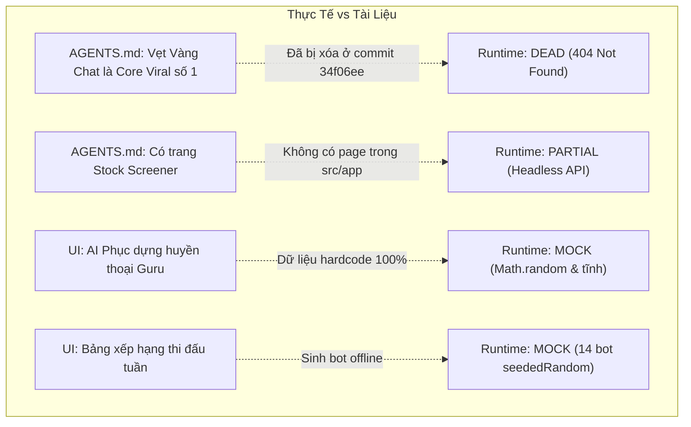

# Báo Cáo Kiểm Toán Thực Tế Vận Hành & Sản Phẩm (Runtime & Product Reality Audit)
**Dự án**: VietFi Advisor (`vietfi-advisor`)  
**Mã kiểm toán**: AUDIT-01-RUNTIME-REALITY  
**Thời gian thực hiện**: 22/09/2026  
**Auditor**: Agent 01 - Runtime & Product Reality Auditor  
**Phạm vi kiểm toán**: Toàn bộ entrypoints trong `src/app` (Pages, Layouts, Route Handlers), luồng dữ liệu E2E (Frontend → API → Service → Database / External APIs / AI Models), và đối chiếu với tài liệu quy chuẩn (`AGENTS.md`, `README.md`).

---

## 1. Tóm Tắt Điều Hành (Executive Summary)

Sau khi quét và đối soát toàn bộ mã nguồn thực tế tại thư mục `src/app`, hệ thống ghi nhận sự phân hóa rõ rệt giữa **Tài liệu đặc tả (Documentation Specification)** và **Mã nguồn chạy thực tế (Runtime Reality)**:

1. **Khối Tài chính cá nhân Client-First (Hoạt động xuất sắc - `WORKING`)**:
   - Các công cụ tính toán thuần logic nghiệp vụ tài chính Việt Nam gồm: **Net Worth**, **Budget (Hũ chi tiêu)**, **Debt (Quản lý nợ & Cấp cứu DTI)**, **Cashflow**, **Ledger (Sổ giao dịch)**, **Housing (Kế hoạch an cư)**, **Learn (Bài học tài chính)**, **Risk Profile (Tính cách đầu tư)**, và **Personal CPI** vận hành rất ổn định, độc lập trên `localStorage` và đồng bộ tự động với Supabase khi đăng nhập.
2. **Khối Dữ liệu thị trường (Cào trực tiếp thành công - `WORKING`)**:
   - Hệ thống crawler dữ liệu trực tiếp từ **CafeF**, **GiaVang**, **DOJI**, **SBV (Ngân hàng Nhà nước)**, **CoinGecko**, **Yahoo Finance** và **VnExpress RSS** hoạt động tốt với cơ chế fallback bộ đệm nhiều tầng (multi-tier fallback cache).
   - **Morning Brief** có cơ chế tự động hạ cấp thông minh: dùng Gemini nếu có API key, tự động chuyển sang heuristic template ghép số liệu thực nếu thiếu key hoặc LLM timeout.
3. **Các điểm phân kỳ nghiêm trọng (Critical Discrepancies & Dead Features)**:
   - **Vẹt Vàng Chat (Mascot Persona)**: Tài liệu `AGENTS.md` khẳng định đây là "tính năng cốt lõi viral số 1" của dự án. Tuy nhiên, kiểm tra mã nguồn và lịch sử Git (commit `34f06ee` ngày 20/04/2026) cho thấy **toàn bộ mã nguồn Chat đã bị xóa sạch**: `src/app/api/chat/route.ts` (xóa 129 dòng), `VetVangChat.tsx` (xóa 799 dòng), `VetVangFloat.tsx` (xóa 177 dòng), `AnimatedParrot.tsx` (xóa 129 dòng). Tại runtime, tính năng này ở trạng thái **`DEAD`**.
   - **Stock Screener**: Có API endpoint `GET /api/stock-screener` kết nối TCBS API, nhưng **hoàn toàn không có UI** trong `src/app` (Headless API - `PARTIAL`).
   - **Guru Personas & Leaderboard**: Giao diện hiển thị rất tinh xảo nhưng **100% dữ liệu là MOCK** cục bộ (Guru chart dùng Math.random, nhận định hardcode; Leaderboard sinh 14 bot ảo bằng thuật toán seededRandom - `MOCK`).
   - **Backtest Pro**: Giao diện và thuật toán phân tích hoàn chỉnh, nhưng API `POST /api/backtest` bắt buộc phải có Supabase kết nối bảng `ohlcv_bars` đã được nạp dữ liệu từ trước. Nếu không có biến môi trường hoặc DB trống, API trả về mã lỗi 500/422 (`PARTIAL`).
   - **Spending Insights**: Thực chất là một bí danh (alias) re-render lại component của trang `Personal CPI`, không phải module phân tích chi tiêu chuyên biệt.

---

## 2. Bản Đồ Entrypoints & Cơ Chế Định Tuyến Thực Tế

### 2.1. Danh mục Entrypoints trong `src/app`

| Loại | Đường dẫn file | Route tương ứng | Trạng thái hiển thị / Chức năng |
| :--- | :--- | :--- | :--- |
| **Page** | `src/app/page.tsx` | `/` | Landing Page giới thiệu VietFi Advisor |
| **Page** | `src/app/auth/login/page.tsx` | `/auth/login` | Form đăng nhập Supabase Auth & Guest Mode |
| **Page** | `src/app/auth/register/page.tsx` | `/auth/register` | Form đăng ký tài khoản mới |
| **Page** | `src/app/login/page.tsx` | `/login` | Chuyển hướng (Redirect) sang `/auth/login` |
| **Page** | `src/app/dashboard/page.tsx` | `/dashboard` | Tổng quan Dashboard (Net Worth, Quests, Market, Brief) |
| **Page** | `src/app/dashboard/cashflow/page.tsx` | `/dashboard/cashflow` | Tab điều phối Dòng tiền (Ngân sách & Giao dịch) |
| **Page** | `src/app/dashboard/budget/page.tsx` | `/dashboard/budget` | Trang Hũ ngân sách (Redirect sang `/dashboard/cashflow?tab=budget`) |
| **Page** | `src/app/dashboard/ledger/page.tsx` | `/dashboard/ledger` | Trang Sổ giao dịch (Redirect sang `/dashboard/cashflow?tab=ledger`) |
| **Page** | `src/app/dashboard/debt/page.tsx` | `/dashboard/debt` | Quản lý Quỹ nợ, Snowball/Avalanche, Cấp cứu DTI |
| **Page** | `src/app/dashboard/market-overview/page.tsx`| `/dashboard/market-overview` | Thị trường đa lớp: Tâm lý, Tài sản, Vĩ mô |
| **Page** | `src/app/dashboard/news/page.tsx` | `/dashboard/news` | Tin tức tài chính RSS CafeF/VnExpress + Sentiment |
| **Page** | `src/app/dashboard/backtest/page.tsx` | `/dashboard/backtest` | Kiểm thử chiến lược chứng khoán Pro |
| **Page** | `src/app/dashboard/housing/page.tsx` | `/dashboard/housing` | Kế hoạch an cư, BĐS, so sánh Mua vs Thuê |
| **Page** | `src/app/dashboard/gurus/page.tsx` | `/dashboard/gurus` | Danh sách 5 huyền thoại đầu tư (Hội đồng Gurus) |
| **Page** | `src/app/dashboard/gurus/[id]/page.tsx` | `/dashboard/gurus/[id]` | Chi tiết từng Guru (Chart mock, watchlist mock) |
| **Page** | `src/app/dashboard/learn/page.tsx` | `/dashboard/learn` | 5 bài học tài chính vi mô + Quiz gamification |
| **Page** | `src/app/dashboard/leaderboard/page.tsx` | `/dashboard/leaderboard` | Bảng xếp hạng tuần (Mô phỏng 14 bot ảo) |
| **Page** | `src/app/dashboard/personal-cpi/page.tsx` | `/dashboard/personal-cpi` | Tính lạm phát cá nhân (Redirect sang `/dashboard/spending-insights`) |
| **Page** | `src/app/dashboard/spending-insights/page.tsx`| `/dashboard/spending-insights`| Re-export trực tiếp từ `PersonalCPIPage` |
| **Page** | `src/app/dashboard/portfolio/page.tsx` | `/dashboard/portfolio` | Cố vấn danh mục, phân bổ động, dự phóng 10 năm |
| **Page** | `src/app/dashboard/risk-profile/page.tsx` | `/dashboard/risk-profile` | Bài test 5 câu hỏi tâm lý rủi ro Prospect Theory |
| **Page** | `src/app/test-ssr/page.tsx` | `/test-ssr` | Dev test SSR kết nối Supabase bảng `todos` |
| **Page** | `src/app/test-supabase/page.tsx` | `/test-supabase` | Dev test Client kết nối Supabase bảng `todos` |
| **Route** | `src/app/api/market-data/route.ts` | `GET /api/market-data` | API snapshot thị trường (VN-Index, SJC, USD, BTC) |
| **Route** | `src/app/api/morning-brief/route.ts` | `GET /api/morning-brief`| API bản tin sáng (Gemini LLM / Heuristic fallback) |
| **Route** | `src/app/api/news/route.ts` | `GET /api/news` | API tin tức tài chính RSS crawler + Sentiment |
| **Route** | `src/app/api/stock-screener/route.ts` | `GET /api/stock-screener`| API bộ lọc cổ phiếu TCBS API |
| **Route** | `src/app/api/backtest/route.ts` | `POST /api/backtest` | API thực thi backtest từ dữ liệu nến Supabase |
| **Route** | `src/app/api/portfolio/backtest/route.ts` | `GET /api/portfolio/backtest` | API mô phỏng hiệu suất danh mục 2021-2026 |
| **Route** | `src/app/api/portfolio/projection/route.ts`| `GET /api/portfolio/projection`| API dự phóng lãi kép 10 năm (3 kịch bản) |
| **Route** | `src/app/api/strategy-engine/route.ts` | `GET /api/strategy-engine` | API headless chạy chiến lược Pullback/VCP |
| **Route** | `src/app/api/tts/route.ts` | `POST /api/tts` | API TTS (Đã vô hiệu hóa: trả về 405 "TTS đã bị tắt") |
| **Route** | `src/app/api/cron/market-data/route.ts` | `POST /api/cron/market-data` | Vercel Cron đồng bộ EOD bar TCBS vào DB |
| **Route** | `src/app/api/cron/morning-brief/route.ts` | `POST /api/cron/morning-brief` | Vercel Cron tạo bản tin sáng 08:00 AM VN |
| **Route** | `src/app/api/cron/sync-market/route.ts` | `POST /api/cron/sync-market` | Vercel Cron đồng bộ snapshot thị trường |
| **Route** | `src/app/api/cron/market-alert/route.ts` | `POST /api/cron/market-alert` | Vercel Cron cảnh báo biến động thị trường |
| **Route** | `src/app/api/cron/macro-update/route.ts` | `POST /api/cron/macro-update` | Vercel Cron cập nhật chỉ tiêu vĩ mô |
| **Route** | `src/app/auth/callback/route.ts` | `GET /auth/callback` | Callback xác thực OAuth Supabase |
| **Route** | `src/app/auth/confirm/route.ts` | `GET /auth/confirm` | Callback xác thực Email Supabase |

---

### 2.2. Cơ chế Điều hướng Ngầm (`src/proxy.ts`)

File `src/proxy.ts` được gọi tại `middleware.ts` đóng vai trò URL Normalizer để hợp nhất giao diện:
- `/dashboard/budget` $\longrightarrow$ Chuyển hướng 307 tới `/dashboard/cashflow?tab=budget`
- `/dashboard/ledger` $\longrightarrow$ Chuyển hướng 307 tới `/dashboard/cashflow?tab=ledger`
- `/dashboard/personal-cpi` $\longrightarrow$ Chuyển hướng 307 tới `/dashboard/spending-insights?tab=inflation`
- `/dashboard/sentiment` $\longrightarrow$ Chuyển hướng 307 tới `/dashboard/market-overview?tab=tam-ly`
- `/dashboard/market` $\longrightarrow$ Chuyển hướng 307 tới `/dashboard/market-overview?tab=tai-san`
- `/dashboard/macro` $\longrightarrow$ Chuyển hướng 307 tới `/dashboard/market-overview?tab=vi-mo`

---

## 3. Bảng Ma Trận Tính Năng Bắt Buộc (Feature Reality Matrix)

*Quy tắc chuẩn: Trạng thái runtime CHỈ ĐƯỢC PHÉP là 1 trong các giá trị: `WORKING`, `PARTIAL`, `MOCK`, `DEAD`, `BROKEN`, `UNKNOWN`.*

| Feature | UI | API | Logic | DB | AI | Runtime status | Notes |
| :--- | :---: | :---: | :---: | :---: | :---: | :---: | :--- |
| **Net worth** | Có | Không | Có | Local + Supabase | Không | **WORKING** | Hiển thị tại Dashboard; tính từ baseline Onboarding hoặc (Hũ - Chi tiêu); biểu đồ lịch sử 12 tháng tính ngược từ sổ giao dịch ledger. |
| **Budget** | Có | Không | Có | Local + Supabase | Không | **WORKING** | Quản lý hũ 6 lọ/tùy biến, thêm/xóa hũ, ghi chi tiêu, biểu đồ Pie phân bổ, xuất CSV. Nằm tại tab `/dashboard/cashflow?tab=budget`. |
| **Debt** | Có | Không | Có | Local + Supabase | Không | **WORKING** | Tối ưu nợ Snowball & Avalanche, tính DTI domino, phát hiện phí ẩn, modal Bác sĩ cấp cứu tài chính khi DTI > 40%, biểu đồ lộ trình trả nợ. |
| **Cashflow** | Có | Không | Có | Local + Supabase | Không | **WORKING** | Shell tab tích hợp đồng thời Ngân sách (`BudgetPage`) và Giao dịch (`LedgerPage`). Điều hướng qua query param `?tab=`. |
| **Backtest** | Có | Có | Có | Cần Supabase DB | Không | **PARTIAL** | UI TradingView + chỉ số Sharpe/Drawdown/WinRate hoàn chỉnh. Nhưng API `POST /api/backtest` bắt buộc có Supabase `ohlcv_bars`. Nếu chưa chạy script seed, API trả về lỗi 500/422. |
| **Guru personas** | Có | Không | Tĩnh | Không | Không | **MOCK** | Trang danh sách 5 Guru hoạt động. Tuy nhiên trang chi tiết `/gurus/[id]` dùng 100% dữ liệu mock: biểu đồ `Math.random()`, nhận định hardcode, 3 mã watchlist cố định. |
| **Housing** | Có | Không | Có | Dữ liệu tĩnh | Không | **WORKING** | Bảng giá BĐS tham chiếu các quận, thông tin NOXH, công cụ tính Affordability và so sánh chi phí Mua vs Thuê (Recharts bar chart). |
| **Leaderboard** | Có | Không | Có | LocalStorage | Không | **MOCK** | UI bảng xếp hạng giải đấu Duolingo rất đẹp nhưng đối thủ là 14 bot ảo được sinh ngẫu nhiên bằng `seededRandom` quanh điểm XP của người dùng. Không có multiplayer backend. |
| **Learn** | Có | Không | Có | LocalStorage | Không | **WORKING** | 5 bài học vi mô (Lãi kép, 50-30-20, DCA, Dự phòng, F&G) + Quiz trắc nghiệm + thưởng XP + pháo hoa Confetti. Hoàn toàn chạy client-side. |
| **Ledger** | Có | Không | Có | LocalStorage | Không | **WORKING** | Sổ ghi thu/chi nhanh, lọc theo ngày/tháng, nút nổi FAB, cơ chế Undo giao dịch tức thì qua Toast. Tích hợp trong Cashflow tab. |
| **Market overview**| Có | Có | Có | App Settings / Fallback | Không | **WORKING** | Gồm 3 tab (Tâm lý F&G, Tài sản VN-Index/Vàng/Bạc/USD/BTC, Vĩ mô GDP/CPI/Lãi suất). Gọi song song `/api/market-data` và `/api/news`, fallback nhiều cấp rất bền bỉ. |
| **News** | Có | Có | Có | In-memory Cache | Heuristic | **WORKING** | Cào RSS từ CafeF, VnEconomy, VnExpress, Tuổi Trẻ. Gắn nhãn cảm xúc theo từ điển Heuristic regex, lọc theo tài sản, bookmark bài viết. |
| **Personal CPI** | Có | Không | Có | LocalStorage | Không | **WORKING** | Thanh trượt trọng số 7 nhóm rổ hàng hóa GSO, nút đồng bộ tự động từ hũ chi tiêu thực tế, tính tỷ lệ lạm phát cá nhân và cảnh báo bào mòn tài sản. |
| **Portfolio** | Có | Có | Có | LocalStorage | Không | **WORKING** | Phân bổ tài sản thích ứng theo Khẩu vị rủi ro & F&G thị trường; tích hợp CashflowDNA, GoldTracker, và đồ thị dự phóng tài sản 10 năm. |
| **Risk profile** | Có | Không | Có | LocalStorage | Không | **WORKING** | Trắc nghiệm 5 câu hỏi tâm lý học tài chính (Prospect Theory), tính điểm xác định nhóm nhà đầu tư (Bảo thủ, Cân bằng, Tăng trưởng), chia sẻ kết quả. |
| **Spending insights**| Có| Không | Có | LocalStorage | Không | **WORKING** | Bản chất là alias re-export component `PersonalCPIPage`. Chưa có biểu đồ chi tiết cơ cấu dòng tiền tiêu dùng chuyên sâu. |
| **Vẹt Vàng Chat** | Không | Không | File rác | Không | Không | **DEAD** | Toàn bộ code giao diện Chat (`VetVangChat`, `VetVangFloat`, `AnimatedParrot`) và Route Handler `POST /api/chat` đã bị xóa khỏi mã nguồn ở commit `34f06ee`. |
| **Morning Brief** | Có | Có | Có | File Cache 24h | Có (Fallback Heuristic) | **WORKING** | Bản tin sáng tự động tổng hợp số liệu VN-Index, Vàng, USD và 4 tin nóng. Tự động gọi Gemini nếu có key, tự động dùng Heuristic template chuẩn nếu không có key. |
| **Stock screener** | Không | Có | Có | TCBS API Cache | Không | **PARTIAL** | API `GET /api/stock-screener` hoạt động tốt (gọi TCBS API, fallback `MOCK_VN30`), nhưng mã nguồn **hoàn toàn không có UI** để người dùng sử dụng. |

---

## 4. Trace Chi Tiết Kỹ Thuật Từng Tính Năng (Trace Pipeline)

### 4.1. Vẹt Vàng AI Chat (Trạng thái: DEAD)
- **Kỳ vọng theo tài liệu (`AGENTS.md`)**:
  `Client (VetVangFloat/VetVangChat) → POST /api/chat (Edge Runtime) → expense-parser → scripted-responses → Gemini Streaming`.
- **Thực tế mã nguồn (Code Reality)**:
  - `src/app/api/chat/route.ts`: **KHÔNG TỒN TẠI** (Bị xóa ở commit `34f06ee`). Nếu client gọi sẽ nhận lỗi HTTP `404 Not Found`.
  - `src/app/dashboard/layout.tsx`: Không còn import hay render `VetVangFloat`.
  - `src/components/vet-vang/`: Thư mục đã bị xóa bỏ hoàn toàn khỏi project.
  - `src/app/api/tts/route.ts`: Mã nguồn trả về cố định `405 Method Not Allowed` với nội dung `"TTS đã bị tắt"`.
- **Dư thừa mã**: Các file `src/lib/scripted-responses.ts` (500+ câu thoại), `src/lib/expense-parser.ts`, `src/lib/vetvang-persona.ts` vẫn còn nằm trong repo nhưng không có runtime caller nào kích hoạt.

### 4.2. Morning Brief (Trạng thái: WORKING)
- **Mạch luồng**:
  $$\text{Dashboard (BriefCard)} \longrightarrow \text{GET /api/morning-brief} \longrightarrow \text{buildMorningBrief()}$$
- **Tầng dịch vụ (`src/lib/application/morning-brief/index.ts`)**:
  1. Gọi song song `crawlMarketData()` (lấy giá VN-Index, Vàng SJC, USD/VND) và `crawlNews({ limitPerSection: 4 })`.
  2. Kiểm tra cờ cấu hình LLM qua `isLlmConfigured()`:
     - Nếu có `GEMINI_API_KEY` hoặc `VERTEX_API` hoặc `OPENAI_API_KEY`: Gửi payload tới `generateMorningBrief()` để nhận phân tích xéo xắt từ AI.
     - Nếu không có API key hoặc LLM timeout: Gọi hàm fallback `buildSimulatedGeminiBrief()`, ghép số liệu thị trường thực tế vào văn bản mẫu.
  3. Cơ chế lưu trữ đệm: In-memory cache 15 phút và file cache `morning-brief` 24 giờ qua `readCronCache` / `writeCronCache`.

### 4.3. Quản Lý Ngân Sách (Budget) & Sổ Giao Dịch (Ledger) (Trạng thái: WORKING)
- **Mạch luồng**:
  $$\text{CashflowPage (?tab=budget / ?tab=ledger)} \longrightarrow \text{useLedgerStore / State} \longrightarrow \text{storage.ts (localStorage)}$$
  $$\Big\downarrow \text{(nếu đã đăng nhập)}$$
  $$\text{Supabase Client} \longrightarrow \text{user-data.ts} \longrightarrow \text{PostgreSQL (tables: pots, expenses, ledger)}$$
- **Xử lý đồng bộ**:
  - Khi người dùng ở chế độ Khách (Guest), dữ liệu lưu trữ 100% trong trình duyệt qua các key: `vietfi_pots`, `vietfi_expenses`, `vietfi_income`, `vietfi_ledger`.
  - Khi đăng nhập tài khoản Supabase, hàm `migrateLocalStorageToSupabase(userId)` trong `src/app/dashboard/layout.tsx` tự động đẩy dữ liệu cục bộ lên bảng đám mây và đánh dấu cờ `vietfi_migrated`.
  - Khi người dùng ghi nhận chi tiêu tại Budget, hệ thống tự động chèn một bản ghi tương ứng vào Sổ giao dịch (`setLedgerEntries`).

### 4.4. Quản Lý Nợ (Debt Optimizer) (Trạng thái: WORKING)
- **Mạch luồng**:
  $$\text{DebtPage} \longrightarrow \text{analyzeDTI() / snowballPlan() / avalanchePlan()} \longrightarrow \text{debt-optimizer.ts}$$
- **Thuật toán & Nghiệp vụ**:
  - Tính tỷ lệ DTI (Debt-to-Income): Phân loại `safe` (<30%), `warning` (30-40%), `danger` (>=40%). Khi DTI >= 40%, banner cảnh báo màu đỏ tự động hiển thị cùng nút kích hoạt `FinancialTriageModal` (Bác sĩ tài chính).
  - Tự động bóc tách **lãi suất thực tế kèm phí ẩn** (`realInterestRates`): Thẻ tín dụng (phí thường niên), Trả góp BNPL (phí tiện ích hàng tháng), Vay tín dụng đen.
  - Dự phóng biểu đồ AreaChart thời gian thoát nợ (Freedom Month) theo 2 chiến lược: Snowball (trả nợ nhỏ trước) hoặc Avalanche (trả lãi suất cao trước).

### 4.5. Backtest Pro (Trạng thái: PARTIAL)
- **Mạch luồng**:
  $$\text{BacktestPage} \longrightarrow \text{POST /api/backtest} \longrightarrow \text{fetchPriceHistory()} \longrightarrow \text{queryOHLCV() (Supabase)}$$
  $$\Big\downarrow$$
  $$\text{runBacktest() (backtest-engine.ts)} \longleftarrow \text{OHLCVBar[] (Nến quá khứ)}$$
- **Điểm nghẽn kỹ thuật (Failure Point)**:
  - API `POST /api/backtest` kiểm tra Auth Guard (yêu cầu Supabase Auth hoặc header `x-demo-bypass: hungpixi-demo`).
  - Hàm `fetchPriceHistory` gọi `queryOHLCV` trong `src/lib/market-data/ohlcv-db.ts`. File này yêu cầu biến môi trường `NEXT_PUBLIC_SUPABASE_URL` và `SUPABASE_SERVICE_ROLE_KEY`.
  - Nếu thiếu env hoặc cơ sở dữ liệu Supabase chưa được chạy script Python `sync_market_data.py` để nạp nến, hàm ném ngoại lệ:
    `"Không có dữ liệu cho ticker... Vui lòng chạy backfill: python scripts/sync_market_data.py"`.
  - Hậu quả: Không có offline mock fallback cho nến lịch sử, tính năng sẽ báo lỗi đỏ trên UI nếu chưa cấu hình DB backend hoàn chỉnh.

### 4.6. Stock Screener (Trạng thái: PARTIAL)
- **Mạch luồng**:
  $$\text{Client (Không có caller)} \;\times\!\longrightarrow\; \text{GET /api/stock-screener} \longrightarrow \text{runScreener()} \longrightarrow \text{TCBS API}$$
- **Thực tế kỹ thuật**:
  - Route handler `src/app/api/stock-screener/route.ts` được lập trình rất bài bản, hỗ trợ lọc theo `maxPE`, `maxPB`, `minROE`, `minMarketCap`, `minRating`, `exchange`.
  - Tầng dịch vụ `src/lib/market-data/stock-screener.ts` kết nối trực tiếp các endpoint công khai của TCBS (`apipubaws.tcbs.com.vn/tcanalysis/v1/...`) và có sẵn danh sách dự phòng `MOCK_VN30` (11 mã VN30) khi TCBS ngắt kết nối.
  - Tuy nhiên, trong `src/app` **hoàn toàn không có trang hoặc component nào sử dụng API này**. Đây là một endpoint "mồ côi" (Orphaned/Headless API).

### 4.7. Guru Personas (Trạng thái: MOCK)
- **Mạch luồng**:
  $$\text{GurusPage (/dashboard/gurus)} \longrightarrow \text{GURU_PERSONAS (guru-personas.ts)}$$
  $$\Big\downarrow$$
  $$\text{GuruDetailPage (/dashboard/gurus/[id])} \longrightarrow \text{Hardcoded JSX + Math.random()}$$
- **Thực tế kỹ thuật**:
  - Dòng 13 file `src/app/dashboard/gurus/[id]/page.tsx` ghi chú rõ: `// Mock data until Supabase is ready`.
  - Biểu đồ hiệu suất 30 ngày sinh bằng `Math.random() * 2000 + (i * 100)`.
  - Phần nhận định thị trường là đoạn text tĩnh cố định.
  - Bảng Watchlist & Vị thế hiện tại hardcode trực tiếp 3 mã (FPT - Đang giữ, GMD - Watchlist, VIX - Đã bán) trong mã nguồn JSX.

---

## 5. Tổng Hợp Các Điểm Bất Thường & Rủi Ro Nghiệp Vụ (Critical Anomalies)

1. **Rủi ro 01: Mascot Vẹt Vàng Chat biến mất hoàn toàn**
   - Sự biến mất của toàn bộ module chat khiến ứng dụng mất đi linh hồn và nhân vật đại diện (mascot persona). Người dùng không thể tương tác trực tiếp bằng ngôn ngữ tự nhiên để parse chi tiêu hay nhận lời khuyên tài chính xéo xắt như mô tả trong tài liệu dự án.
2. **Rủi ro 02: Stock Screener thiếu giao diện người dùng**
   - API được viết hoàn chỉnh nhưng không có trang hiển thị trên frontend, gây lãng phí tính năng và không mang lại giá trị thực tế cho người dùng nếu chỉ lướt app.
3. **Rủi ro 03: Phụ thuộc dữ liệu cứng của Backtest**
   - Việc thiếu cơ chế dự phòng dữ liệu nến cục bộ (local fallback data) khiến tính năng Backtest Pro hoàn toàn bị tê liệt khi triển khai môi trường mới hoặc khi cơ sở dữ liệu Supabase chưa được backfill.
4. **Rủi ro 04: Nhầm lẫn giữa Spending Insights và Personal CPI**
   - Menu hiển thị 2 mục riêng biệt ("Phân tích chi tiêu" và "Lạm phát cá nhân"), nhưng thực chất cả 2 đường dẫn đều trỏ về một component duy nhất tính chỉ số CPI cá nhân. Ứng dụng chưa có màn hình phân tích trực quan chi tiết thói quen tiêu dùng theo thời gian.

---

## 6. Kết Luận & Khuyến Nghị Kiểm Toán

- **Về độ ổn định chung**: Bộ khung ứng dụng Next.js 16 + React 19 chạy ổn định. Các module tính toán tài chính cá nhân cục bộ (Local-First Financial Engines) hoạt động chính xác, giao diện sắc nét, tuân thủ phong cách Cyber-Technical nhất quán và không gặp lỗi vỡ layout.
- **Khuyến nghị cho Phase tiếp theo**:
  1. Khôi phục lại giao diện chat và endpoint `api/chat` từ lịch sử Git nếu Vẹt Vàng Mascot vẫn là yêu cầu bắt buộc của cuộc thi WDA2026.
  2. Xây dựng giao diện UI cho `Stock Screener` (kết nối endpoint `/api/stock-screener` có sẵn).
  3. Bổ sung bộ nến mẫu (sample OHLCV fallback) cho các mã trụ (FPT, VCB, HPG) trong trường hợp Supabase chưa được seed dữ liệu, tránh gây lỗi 500 cho người dùng trải nghiệm thử.
  4. Cập nhật lại tài liệu `AGENTS.md` và `README.md` để phản ánh đúng hiện trạng thực tế của mã nguồn.
