# BÁO CÁO AUDIT TOÀN DIỆN HỆ THỐNG API & BACKEND (AGENT 03)
**Dự án:** VietFi Advisor (`vietfi-advisor`)  
**Vị trí:** `src/app/api/`  
**Ngày thực hiện:** 22/09/2026  
**Người thực hiện:** Agent 03: API & Backend Auditor  
**Phạm vi:** Kiểm toán 100% các endpoint API, sơ đồ phụ thuộc (API Graph), phân tích Caller-Input-Output-Auth-DB-Cache, phát hiện lỗi kiến trúc, chuỗi proxy, endpoint rác, lãng phí AI và rủi ro Vercel Serverless.

---

## 1. TỔNG QUAN HỆ THỐNG API (EXECUTIVE SUMMARY)

Qua rà soát toàn bộ thư mục `src/app/api/`, hệ thống backend hiện đang vận hành theo mô hình **Next.js 16 App Router Route Handlers** kết hợp **Supabase PostgreSQL** và **Vercel Serverless Functions**.

### Bảng thống kê nhanh
| Chỉ số | Số lượng | Ghi chú |
| :--- | :---: | :--- |
| **Tổng số Endpoint Route Handlers hiện có** | **14** | 5 User Data APIs, 5 Cron APIs, 4 Utility/Orphaned APIs |
| **Endpoint Ghost (Đã bị xóa khỏi code nhưng còn trong doc/test)** | **1** | `POST /api/chat` (xóa tại commit `34f06eef`) |
| **Endpoint Cần thiết (Core Business)** | **5** | `/api/market-data`, `/api/morning-brief`, `/api/news`, `/api/backtest`, `/api/cron/morning-brief` |
| **Endpoint Lãng phí / Có thể chuyển Client Calculation** | **2** | `/api/portfolio/backtest`, `/api/portfolio/projection` |
| **Endpoint Mồ côi (Orphaned - Không có Frontend caller)** | **2** | `/api/stock-screener`, `/api/strategy-engine` |
| **Endpoint Dead / Stub** | **1** | `POST /api/tts` (trả về 405 cứng "TTS đã bị tắt") |
| **Endpoint Cron bị lỗi thiết kế / Xung đột** | **3** | `/api/cron/sync-market` (bug biến `b.symbol`), `/api/cron/macro-update` (dữ liệu không ai đọc), `/api/cron/morning-brief` (lỗi method POST trên Vercel Cron) |

---

## 2. TOÀN BỘ SƠ ĐỒ HỆ THỐNG API (COMPLETE API GRAPH)

Biểu đồ Mermaid dưới đây mô tả luồng dữ liệu từ các **Callers (Trình duyệt, Cron, GitHub Actions)** qua các **API Endpoints**, tầng **Application Services**, kết nối tới các **External Data Providers** và **Database Supabase**.

```mermaid
graph TD
    %% ================= CALLERS =================
    subgraph CALLERS ["🌐 TẦNG GỌI (CALLERS)"]
        UI_Home["Trang Chủ (/dashboard)"]
        UI_Market["Market Overview (/market-overview)"]
        UI_Portfolio["Trang Portfolio (/portfolio)"]
        UI_Backtest["Trang Backtest (/backtest)"]
        UI_News["Trang Tin Tức (/news)"]
        Internal_Alert["Client Hook (useMarketAlert)"]
        Vercel_Cron["⏱️ Vercel Cron Scheduler (GET)"]
        GH_Actions["🤖 GitHub Actions Runner (POST)"]
    end

    %% ================= API LAYER =================
    subgraph API_CORE ["⚡ CORE DATA APIS"]
        API_MarketData["GET /api/market-data<br/><i>(1m RAM + 15m DB Cache)</i>"]
        API_News["GET /api/news<br/><i>(10m RAM Cache)</i>"]
        API_MorningBrief["GET /api/morning-brief<br/><i>(24h Supabase Cache)</i>"]
    end

    subgraph API_CALC ["🧮 CALCULATION & ENGINE APIS"]
        API_Backtest["POST /api/backtest<br/><i>(Auth Guarded, 24h Price Cache)</i>"]
        API_PortBacktest["GET /api/portfolio/backtest<br/><i>⚠️ Useless API (Pure Math)</i>"]
        API_PortProjection["GET /api/portfolio/projection<br/><i>⚠️ Useless API (Compound Interest)</i>"]
        API_Strategy["GET /api/strategy-engine<br/><i>⚠️ Orphaned, No Auth</i>"]
    end

    subgraph API_CRON ["🕒 AUTOMATION & CRON APIS"]
        Cron_MB["POST /api/cron/morning-brief<br/><i>⚠️ 405 on Vercel GET</i>"]
        Cron_SyncMkt["GET /api/cron/sync-market<br/><i>⚠️ Bug b.symbol + Timeout risk</i>"]
        Cron_MktAlert["GET /api/cron/market-alert<br/><i>(Telegram Webhook)</i>"]
        Cron_MktData["POST /api/cron/market-data<br/><i>⚠️ Trùng lặp với sync-market</i>"]
        Cron_Macro["POST /api/cron/macro-update<br/><i>⚠️ Dữ liệu lưu không ai đọc</i>"]
    end

    subgraph API_DEAD ["🗑️ DEAD & ORPHANED APIS"]
        API_TTS["POST /api/tts<br/><i>(Dead 405 Stub)</i>"]
        API_Screener["GET /api/stock-screener<br/><i>(Orphaned TCBS Proxy)</i>"]
        API_Chat["POST /api/chat<br/><i>(Ghost - Deleted in code)</i>"]
    end

    %% ================= APPLICATION LOGIC =================
    subgraph APP_SERVICES ["⚙️ APPLICATION SERVICES & LOGIC"]
        Svc_Crawler["crawlMarketData()<br/><i>(Multi-provider crawler)</i>"]
        Svc_NewsCrawler["crawlNews()<br/><i>(8 RSS Feeds + Cheerio)</i>"]
        Svc_BriefEngine["getMorningBriefCached()<br/><i>(Orchestrator)</i>"]
        Svc_BacktestEngine["runBacktest()<br/><i>(OHLCV Algorithm)</i>"]
        Svc_StratManager["StrategyManager<br/><i>(Pullback & VCP)</i>"]
    end

    %% ================= EXTERNAL APIS =================
    subgraph EXTERNAL_APIS ["🌍 EXTERNAL PROVIDERS"]
        Ext_CafeF["CafeF MSH & RSS"]
        Ext_Yahoo["Yahoo Finance (GC=F, SI=F)"]
        Ext_Gold["giavang.com.vn / Doji / Webgia"]
        Ext_SBV["SBV (sbv.gov.vn) / open.er-api"]
        Ext_CoinGecko["CoinGecko (BTC)"]
        Ext_TCBS["TCBS Public & Insight API"]
        Ext_DNSE["DNSE Entrade API"]
        Ext_Gemini["Google Gemini LLM"]
        Ext_Telegram["Telegram Webhook"]
    end

    %% ================= DATABASE =================
    subgraph DATABASE ["💾 SUPABASE POSTGRESQL"]
        DB_OHLCV[("ohlcv_bars<br/><i>(Historical Daily Bars)</i>")]
        DB_CronCache[("cron_cache<br/><i>(market-data, morning-brief)</i>")]
        DB_Settings[("app_settings<br/><i>(macro_data)</i>")]
        DB_Tickers[("tickers<br/><i>(Universe VN30)</i>")]
    end

    %% ================= WIRING =================
    %% UI Calls
    UI_Home --> API_MarketData
    UI_Home --> API_News
    UI_Home --> API_MorningBrief
    UI_Market --> API_MarketData
    UI_Market --> API_News
    UI_Portfolio --> API_MarketData
    UI_Portfolio --> API_PortBacktest
    UI_Portfolio --> API_PortProjection
    UI_Backtest --> API_Backtest
    UI_News --> API_News
    Internal_Alert --> API_MarketData

    %% Cron Calls
    Vercel_Cron -.->|Gửi GET -> Lỗi 405!| Cron_MB
    Vercel_Cron -->|Gửi GET| Cron_SyncMkt
    Vercel_Cron -->|Gửi GET| Cron_MktAlert
    GH_Actions -->|Gửi POST| Cron_MB
    GH_Actions -->|Gửi POST| Cron_MktData
    GH_Actions -->|Gửi POST| Cron_Macro

    %% API to App Services
    API_MarketData --> Svc_Crawler
    API_News --> Svc_NewsCrawler
    API_MorningBrief --> Svc_BriefEngine
    API_Backtest --> Svc_BacktestEngine
    API_Strategy --> Svc_StratManager
    Cron_MB --> Svc_BriefEngine
    Cron_MktData --> Svc_Crawler
    Cron_Macro --> Svc_Crawler
    Cron_MktAlert --> Svc_StratManager

    %% App Services to External
    Svc_Crawler --> Ext_CafeF
    Svc_Crawler --> Ext_Yahoo
    Svc_Crawler --> Ext_Gold
    Svc_Crawler --> Ext_SBV
    Svc_Crawler --> Ext_CoinGecko
    Svc_Crawler -.->|AI Summary| Ext_Gemini
    Svc_NewsCrawler --> Ext_CafeF
    Svc_BriefEngine --> Ext_Gemini
    Cron_SyncMkt --> Ext_DNSE
    Cron_MktData --> Ext_TCBS
    API_Screener --> Ext_TCBS
    Cron_MktAlert --> Ext_Telegram

    %% App Services to DB
    API_Backtest --> DB_OHLCV
    API_Strategy --> DB_OHLCV
    Svc_Crawler --> DB_Settings
    API_MarketData <--> DB_CronCache
    API_MorningBrief <--> DB_CronCache
    Cron_MB --> DB_CronCache
    Cron_MktData --> DB_CronCache
    Cron_MktData --> DB_OHLCV
    Cron_SyncMkt --> DB_OHLCV
    Cron_Macro --> DB_CronCache
    Cron_MktAlert --> DB_Tickers
    Cron_MktAlert --> DB_OHLCV

    %% Styling
    classDef useless fill:#fee2e2,stroke:#ef4444,stroke-width:1.5px;
    classDef dead fill:#f3f4f6,stroke:#9ca3af,stroke-width:1px,stroke-dasharray: 4 4;
    classDef warning fill:#fef3c7,stroke:#f59e0b,stroke-width:1.5px;
    classDef core fill:#dcfce7,stroke:#22c55e,stroke-width:1.5px;

    class API_PortBacktest,API_PortProjection useless;
    class API_TTS,API_Chat,API_Screener dead;
    class Cron_MB,Cron_SyncMkt,Cron_Macro,API_Strategy warning;
    class API_MarketData,API_News,API_MorningBrief,API_Backtest core;
```



---

## 3. BẢNG PHÂN TÍCH CHI TIẾT TỪNG API ROUTE (DETAILED SPECIFICATION MATRIX)

Dưới đây là thông số kỹ thuật chi tiết của toàn bộ 14 API Route Handlers hiện có và 1 Ghost Route:

### 3.1. Nhóm Core User Data Endpoints

#### 1. `POST /api/backtest`
* **File:** `src/app/api/backtest/route.ts`
* **Caller:** `src/app/dashboard/backtest/page.tsx`
* **Input Schema:**
  ```json
  {
    "ticker": "string (2-10 ký tự, VD: FPT, VCB)",
    "fromDate": "YYYY-MM-DD",
    "toDate": "YYYY-MM-DD (fromDate < toDate)",
    "strategy": "buy-and-hold | sma-cross | breakout-52w | ma30w-stage2 | tactical-allocation",
    "capital": "number (1,000,000 đến 100,000,000,000 VND)",
    "smaFast": "number (tuỳ chọn, default 20)",
    "smaSlow": "number (tuỳ chọn, default 50)",
    "equityWeight": "number (tuỳ chọn, default 0.7)",
    "cashYield": "number (tuỳ chọn, default 0.06)",
    "guru": "string (tuỳ chọn slug: livermore, buffett, o-neil, minervini)"
  }
  ```
* **Output Schema:**
  ```json
  {
    "ticker": "string",
    "strategy": "string",
    "capital": "number",
    "fromDate": "string",
    "toDate": "string",
    "bars": "number",
    "fetchedAt": "ISO string",
    "ohlcv": "Array<{ date, open, high, low, close, volume }>",
    "equityCurve": "Array<{ date, equity, cash, shares, close, benchmarkEquity }>",
    "trades": "Array<{ entryDate, exitDate, entryPrice, exitPrice, returnPct, reason, pnl, holdingPeriodDays, type }>",
    "metrics": {
      "totalReturn": "number",
      "cagr": "number",
      "maxDrawdown": "number",
      "sharpeRatio": "number",
      "winRate": "number",
      "profitFactor": "number",
      "totalTrades": "number",
      "winningTrades": "number",
      "losingTrades": "number",
      "avgTradeReturn": "number",
      "maxWin": "number",
      "maxLoss": "number"
    }
  }
  ```
* **Auth / Protection:** Bắt buộc đăng nhập Supabase (`supabase.auth.getUser()`), ngoại trừ trường hợp có header bypass test `x-demo-bypass: hungpixi-demo`. **Chưa có Rate Limit!**
* **External API:** Không gọi external trực tiếp (dùng data trong DB).
* **DB Access:** Đọc bảng `ohlcv_bars` từ Supabase qua `queryOHLCV()`.
* **Cache Strategy:** Server-side cache `unstable_cache` với TTL 24 giờ (`revalidate: 86400`). Response trả về `Cache-Control: no-store`.
* **Payload Size ước tính:** **150 KB – 450 KB** (Rất nặng vì trả về toàn bộ 750–1.250 nến `ohlcv` kèm toàn bộ mảng `equityCurve` từng ngày).
* **Đánh giá cần thiết:** **CẦN THIẾT** (Trọng tâm cuộc thi WDA2026).

---

#### 2. `GET /api/market-data`
* **File:** `src/app/api/market-data/route.ts`
* **Caller:**
  - `src/app/dashboard/components/MarketSection.tsx`
  - `src/app/dashboard/portfolio/page.tsx`
  - `src/lib/market-overview/useMarketOverview.ts`
  - `src/lib/application/market-alert/index.ts` *(Lưu ý: Gọi nội bộ từ client qua fetch)*
* **Input Schema:** Không nhận query params.
* **Output Schema:**
  ```json
  {
    "fetchedAt": "ISO string",
    "vnIndex": { "price": 0, "change": 0, "changePct": 0, "volume": "string", "gtgdTyVnd": "string", "source": "string" },
    "goldSjc": { "goldUsd": 0, "goldVnd": 0, "changePct": 0, "source": "string" },
    "silver": { "silverUsd": 0, "silverVnd": 0, "changePct": 0, "source": "string" },
    "goldBrands": { "PNJ_SJC": { "buy": 0, "sell": 0 }, "BTMC_NHAN": { "buy": 0, "sell": 0 } },
    "usdVnd": { "rate": 0, "source": "string" },
    "btc": { "priceUsd": 0, "changePct24h": 0, "source": "string" },
    "news": "Array<{ title, link, pubDate }>",
    "macro": { "gdpYoY": [...], "cpiYoY": [...], "deposit12m": { "min": 0, "max": 0, "source": "string" } },
    "aiSummary": "string | null",
    "stale": "boolean"
  }
  ```
* **Auth / Protection:** Public API. Rate limit bộ nhớ trong: **60 requests/phút** theo Client IP/User-Agent.
* **External API:**
  - CafeF MSH Data API (`msh-appdata.cafef.vn/rest-api/api/v1/StockMarket`)
  - Yahoo Finance (`GC=F` Vàng, `SI=F` Bạc)
  - CoinGecko (`bitcoin`)
  - Webgia / giavang.com.vn / Doji (Giá vàng đa thương hiệu)
  - SBV (`sbv.gov.vn`) / open.er-api.com (Tỷ giá USD/VND)
  - CafeF RSS (Lấy tin vắn)
  - Google Gemini AI (`callGemini`) cho nhận định `aiSummary` (chạy ngầm non-blocking).
* **DB Access:**
  - Bảng `app_settings` (đọc `macro_data`).
  - Bảng `cron_cache` (đọc/ghi `job_key = 'market-data'`).
* **Cache Strategy:** 2 cấp độ:
  - Cấp 1: Bộ nhớ RAM biến singleton `cache` (TTL 1 phút, hỗ trợ stale-while-revalidate ngầm).
  - Cấp 2: Supabase `cron_cache` (TTL 15 phút).
* **Payload Size ước tính:** **4 KB – 8 KB**.
* **Đánh giá cần thiết:** **CẦN THIẾT** (Xương sống dữ liệu vĩ mô và thị trường của app).

---

#### 3. `GET /api/morning-brief`
* **File:** `src/app/api/morning-brief/route.ts`
* **Caller:** `src/app/dashboard/page.tsx`
* **Input Schema:** Không nhận query params.
* **Output Schema:**
  ```json
  {
    "date": "string (YYYY-MM-DD)",
    "title": "string",
    "summary": "string",
    "raw": "string",
    "source": "gemini | heuristic",
    "takeaways": [
      { "emoji": "🟢 | 🔴 | 🟡", "asset": "string", "text": "string" }
    ],
    "stale": "boolean"
  }
  ```
* **Auth / Protection:** Public API. Rate limit: **30 requests/phút**.
* **External API:**
  - Kích hoạt toàn bộ `crawlMarketData()` và `crawlNews()` (8 RSS feeds).
  - Google Gemini AI qua `generateMorningBrief()` (Prompt tạo nhận định buổi sáng).
* **DB Access:** Bảng `cron_cache` (`job_key = 'morning-brief'`).
* **Cache Strategy:**
  - Ưu tiên đọc từ `cron_cache` Supabase (TTL **24 giờ**).
  - Nếu cache miss hoặc stale >24h: sinh mới qua LLM/heuristic và ghi đè vào `cron_cache`.
* **Payload Size ước tính:** **2 KB – 4 KB**.
* **Đánh giá cần thiết:** **CẦN THIẾT** (Tính năng AI Morning Brief giữ chân người dùng).

---

#### 4. `GET /api/news`
* **File:** `src/app/api/news/route.ts`
* **Caller:**
  - `src/app/dashboard/news/page.tsx`
  - `src/app/dashboard/page.tsx`
  - `src/lib/market-overview/useMarketOverview.ts`
* **Input Schema:** Không nhận query params.
* **Output Schema:**
  ```json
  {
    "fetchedAt": "ISO string",
    "articles": "Array<{ id, category, title, link, published, summary, content, source, sentiment, sentimentScore, asset }>",
    "metrics": {
      "fetchedAt": "ISO string",
      "totalArticles": "number",
      "sentimentCounts": { "bullish": 0, "bearish": 0, "neutral": 0 },
      "overallNewsScore": "number (0-100)",
      "overallZone": "extreme_fear | fear | neutral | greed | extreme_greed",
      "assetSentiment": "Array<{ asset, score, trend, news, articleCount }>",
      "history": "Array<{ date, score }>"
    },
    "stale": "boolean"
  }
  ```
* **Auth / Protection:** Public API. Rate limit: **60 requests/phút**.
* **External API:** 8 RSS Feeds từ CafeF, VnEconomy, VnExpress, Tuổi Trẻ. (Đã tắt AI Review ở route: `enableAiReview: false`).
* **DB Access:** Không.
* **Cache Strategy:** In-memory RAM singleton (`CACHE_TTL_MS = 10 phút`), hỗ trợ stale-while-revalidate.
* **Payload Size ước tính:** **40 KB – 95 KB** (Khá nặng do trả về hàng chục bài viết chi tiết).
* **Đánh giá cần thiết:** **CẦN THIẾT**, nhưng đang bị lãng phí băng thông và trùng lặp việc cào RSS với `/api/market-data`.

---

### 3.2. Nhóm Tính Toán Cục Bộ & Mồ Côi (Useless & Orphaned Endpoints)

#### 5. `GET /api/portfolio/backtest`
* **File:** `src/app/api/portfolio/backtest/route.ts`
* **Caller:** `src/app/dashboard/portfolio/page.tsx`
* **Input Schema:**
  - `capital`: number (default 100,000,000 VND)
  - `riskType`: "conservative" | "balanced" | "growth"
* **Output Schema:**
  ```json
  {
    "description": "string",
    "startInvested": "number",
    "currentValue": "number",
    "cagr": "number",
    "allocations": { "deposit": 0.3, "gold": 0.2, "vnindex": 0.3, "ustech": 0.2, "crypto": 0.0 },
    "history": "Array<{ date, year, portfolioValue }>" // ~60 điểm tháng
  }
  ```
* **Auth / Protection:** Public API. Rate limit: **60 requests/phút**.
* **External API:** **0 (Hoàn toàn không có)**.
* **DB Access:** **0 (Không chạm database)**.
* **Cache Strategy:** `Cache-Control: no-store`.
* **Payload Size ước tính:** ~3 KB.
* **Đánh giá cần thiết:** ❌ **KHÔNG CẦN THIẾT LÀM API (Useless API Route)**.
  - **Lý do:** Toàn bộ dữ liệu dựa trên một mảng tĩnh gồm 6 mốc năm từ 2021 đến 2026, nội suy tuyến tính kèm `Math.random()`. Không có dữ liệu lịch sử thật, không có database, không có AI. Việc đóng gói logic này thành một Serverless API Route làm phát sinh thêm 1 network roundtrip (~150-300ms) và nguy cơ cold start không đáng có. Nên chuyển thành pure TypeScript function chạy ngay trên browser.

---

#### 6. `GET /api/portfolio/projection`
* **File:** `src/app/api/portfolio/projection/route.ts`
* **Caller:** `src/app/dashboard/portfolio/page.tsx`
* **Input Schema:**
  - `capital`: number (default 100,000,000 VND)
  - `riskType`: "conservative" | "balanced" | "growth"
* **Output Schema:**
  ```json
  {
    "description": "string",
    "scenarios": ["Bull Market (14% CAGR)", "Base Case (9% CAGR)", "Bear Market (4% CAGR)"],
    "currentValue": "number",
    "data": "Array<{ year, optimistic, base, pessimistic }>" // Đúng 11 điểm năm
  }
  ```
* **Auth / Protection:** Public API. Rate limit: **60 requests/phút**.
* **External API:** **0**.
* **DB Access:** **0**.
* **Cache Strategy:** `Cache-Control: no-store`.
* **Payload Size ước tính:** ~1 KB.
* **Đánh giá cần thiết:** ❌ **KHÔNG CẦN THIẾT LÀM API (Useless API Route)**.
  - **Lý do:** Logic chỉ là một vòng lặp 10 lần áp dụng công thức lãi kép cơ bản $A = P(1+r)^t$. Việc tốn một Serverless endpoint của Vercel cho phép tính 10 dòng toán phổ thông là phản kiến trúc. Nên chuyển thẳng thành hàm pure math tại `src/lib/calculations/`.

---

#### 7. `GET /api/stock-screener`
* **File:** `src/app/api/stock-screener/route.ts`
* **Caller:** **KHÔNG CÓ AI GỌI (Orphaned)**. Không có bất kỳ trang hay component nào trong `src/` gọi endpoint này (chỉ nằm sót lại trong danh sách cache của `public/sw.js`).
* **Input Schema:** `maxPE`, `maxPB`, `minROE`, `minMarketCap`, `minRating`, `exchange`.
* **Output Schema:** `{ fetchedAt, filters, total, stocks: ScreenerResult[] }`.
* **Auth / Protection:** Public, rate limit 30 req/min.
* **External API:** Gọi TCBS Public API (`apipubaws.tcbs.com.vn/tcanalysis/v1`).
* **DB Access:** Không.
* **Cache Strategy:** In-memory LRU Map cache (TTL 30 phút, tối đa 32 keys).
* **Payload Size ước tính:** 15 KB – 80 KB.
* **Đánh giá cần thiết:** ⚠️ **ORPHANED CODE**. Nếu app chưa có trang Bộ lọc cổ phiếu (Stock Screener UI) thì endpoint này đang là gánh nặng bảo trì vô ích.

---

#### 8. `GET /api/strategy-engine`
* **File:** `src/app/api/strategy-engine/route.ts`
* **Caller:** **KHÔNG CÓ AI GỌI (Orphaned)**. Không có trang UI nào kết nối.
* **Input Schema:** `ticker` (default FPT), `from`, `to`, `strategy` (pullback | vcp | all).
* **Output Schema:** `{ success: true, ticker, reports: [...] }`.
* **Auth / Protection:** 🚨 **KHÔNG CÓ AUTH, KHÔNG CÓ RATE LIMIT!** Bất kỳ ai cũng có thể spam query.
* **External API:** Không.
* **DB Access:** Truy vấn nặng trên bảng `ohlcv_bars` trong Supabase.
* **Cache Strategy:** Không cache.
* **Payload Size ước tính:** 5 KB – 25 KB.
* **Đánh giá cần thiết:** 🚨 **NGUY HIỂM & MỒ CÔI**. Endpoint không có người dùng, không được bảo vệ, có thể trở thành vector DoS trực tiếp làm cạn quota Supabase Database.

---

#### 9. `POST /api/tts`
* **File:** `src/app/api/tts/route.ts`
* **Caller:** **KHÔNG CÓ**.
* **Input Schema:** Bất kỳ.
* **Output Schema:** `{ "error": "TTS đã bị tắt" }` (HTTP 405).
* **Auth / Protection:** Không.
* **External API / DB:** Không.
* **Payload Size ước tính:** 40 bytes.
* **Đánh giá cần thiết:** ❌ **DEAD STUB ENDPOINT**. Nên xóa bỏ hoàn toàn.

---

### 3.3. Nhóm Automation & Vercel Cron Endpoints

#### 10. `POST /api/cron/morning-brief`
* **File:** `src/app/api/cron/morning-brief/route.ts`
* **Caller:**
  - `vercel.json` (schedule `0 1 * * 1-5` lúc 08:00 sáng VN).
  - GitHub Actions `.github/workflows/api-cron-runner.yml` lúc 06:00 sáng VN.
* **Input Schema:** Header `Authorization: Bearer <CRON_SECRET>`.
* **Output Schema:** `{ status: "ok", persisted: true, brief: {...} }`.
* **Auth / Protection:** Bắt buộc Bearer Secret (`CRON_SECRET`).
* **External API:** `crawlMarketData()`, `crawlNews()`, Google Gemini AI.
* **DB Access:** Ghi đè Supabase `cron_cache` (`job_key = 'morning-brief'`).
* **Cache Strategy:** Làm mới cache 24h.
* **Payload Size ước tính:** 2 KB – 4 KB.
* **Đánh giá cần thiết:** **CẦN THIẾT**, **NHƯNG ĐANG CÓ BUG NGHIÊM TRỌNG:**
  - 🚨 **Vercel Cron gửi request HTTP GET**, nhưng route này chỉ khai báo `export async function POST`. Kết quả: Vercel Cron khi chạy sẽ bị **HTTP 405 Method Not Allowed**!

---

#### 11. `GET /api/cron/sync-market`
* **File:** `src/app/api/cron/sync-market/route.ts`
* **Caller:** `vercel.json` (schedule `30 11 * * 1-5` lúc 18:30 VN).
* **Input Schema:** Query `?key=<CRON_SECRET>` hoặc Header `Authorization: Bearer <CRON_SECRET>`.
* **Output Schema:** `{ success: true, upsertedRows: number, processedTickers: string[] }`.
* **Auth / Protection:** Kiểm tra `CRON_SECRET`.
* **External API:** DNSE Entrade API (`services.entrade.com.vn/chart-api/v2/ohlcs/stock`).
* **DB Access:** Upsert dữ liệu hàng loạt vào bảng `ohlcv_bars`.
* **Cache Strategy:** Không.
* **Payload Size ước tính:** ~1 KB.
* **Đánh giá cần thiết:** 🚨 **XUNG ĐỘT & LỖI LOGIC NGHIÊM TRỌNG:**
  - **Trùng lặp:** Cùng làm nhiệm vụ đồng bộ nến ngày với `/api/cron/market-data`, nhưng route này gọi DNSE, còn route kia gọi TCBS!
  - **Bug logic:** Hàm `fetchOHLCVDNSE` trả về object có field `ticker`, nhưng tại dòng 60 và 66 trong route lại đọc `b.symbol`. Kết quả là `ticker: undefined`, gây lỗi hoặc hỏng dữ liệu khi upsert Supabase.
  - **Nguy cơ Timeout:** Duyệt tuần tự 31 mã VN30 kèm `setTimeout 200ms`, tổng thời gian chạy >20s chắc chắn vượt quá giới hạn 10s của Vercel Hobby.

---

#### 12. `POST /api/cron/market-data`
* **File:** `src/app/api/cron/market-data/route.ts`
* **Caller:** GitHub Actions `.github/workflows/api-cron-runner.yml` (`30 8 * * 1-5` lúc 15:30 VN). Không có trong `vercel.json`.
* **Input Schema:** Header `Authorization: Bearer <CRON_SECRET>`.
* **Output Schema:** `{ status: "ok", persisted: true, vnIndex: number, ohlcvSync: {...} }`.
* **Auth / Protection:** Bearer `CRON_SECRET`.
* **External API:** `crawlMarketData()` + TCBS Insight API (`apipubaws.tcbs.com.vn/stock-insight/v1/stock/bars-long-term`).
* **DB Access:** Ghi `cron_cache` (`job_key = 'market-data'`) và upsert vào `ohlcv_bars` (12 mã cổ phiếu).
* **Cache Strategy:** Ghi đè `cron_cache`.
* **Payload Size ước tính:** ~1 KB.
* **Đánh giá cần thiết:** ⚠️ **BỊ PHÂN MẢNH VỚI `sync-market`**. Cần hợp nhất làm một.

---

#### 13. `GET /api/cron/market-alert`
* **File:** `src/app/api/cron/market-alert/route.ts`
* **Caller:** `vercel.json` (schedule `35 11 * * 1-5` lúc 18:35 VN).
* **Input Schema:** Query `?key=<CRON_SECRET>` hoặc Header `Authorization: Bearer <CRON_SECRET>`.
* **Output Schema:** `{ success: true, scanned: number, signals: number, data: [...] }`.
* **Auth / Protection:** Bearer `CRON_SECRET` hoặc query key.
* **External API:** Telegram Webhook (`TELEGRAM_WEBHOOK_URL`).
* **DB Access:** Đọc `tickers` và đọc dữ liệu nến từ `ohlcv_bars`.
* **Cache Strategy:** Không.
* **Payload Size ước tính:** ~2 KB.
* **Đánh giá cần thiết:** **CẦN THIẾT**, nhưng chạy vòng lặp tuần tự qua toàn bộ Universe, tiềm ẩn nguy cơ timeout serverless.

---

#### 14. `POST /api/cron/macro-update`
* **File:** `src/app/api/cron/macro-update/route.ts`
* **Caller:** GitHub Actions `.github/workflows/api-cron-runner.yml` (chạy hàng tháng ngày mùng 1). Không có trong `vercel.json`.
* **Input Schema:** Header `Authorization: Bearer <CRON_SECRET>`.
* **Output Schema:** `{ status: "ok", updatedAt: "string", source: "string", macro: {...}, usdVnd: {...}, vnIndex: {...} }`.
* **Auth / Protection:** Bearer `CRON_SECRET`.
* **External API:** Gọi toàn bộ `crawlMarketData()`.
* **DB Access:** Ghi vào `cron_cache` (`job_key = 'macro-update'`).
* **Cache Strategy:** Ghi `cron_cache`.
* **Payload Size ước tính:** ~1 KB.
* **Đánh giá cần thiết:** ❌ **HOÀN TOÀN VÔ ÍCH (Dead Weight)**.
  - **Lý do:** Dữ liệu vĩ mô ghi vào `cron_cache` với key `macro-update`, nhưng **KHÔNG CÓ BẤT KỲ MÀN HÌNH HOẶC ENDPOINT NÀO TRONG DỰ ÁN ĐỌC KEY NÀY**. Toàn bộ hệ thống hiện đang đọc trực tiếp từ `app_settings` (`key = 'macro_data'`) hoặc qua `/api/market-data`. Việc chạy cron này vừa tốn thời gian vừa lãng phí tài nguyên.

---

### 3.4. Ghost Endpoint (Đã xóa nhưng còn tàn tích)

#### 15. `POST /api/chat` (GHOST ENDPOINT)
* **File ban đầu:** `src/app/api/chat/route.ts` *(Đã bị xóa ở commit `34f06eef`)*.
* **Caller ban đầu:** `src/components/vet-vang/VetVangChat.tsx` *(Cũng đã bị xóa)*.
* **Thực trạng hiện tại:**
  - Vẫn được mô tả trong `AGENTS.md` như là luồng chính: *"Gemini streaming (src/lib/gemini.ts + POST /api/chat) — Edge Runtime..."*.
  - Vẫn được mô tả trong các file tài liệu kiến trúc VPS và security: `docs/superpowers/plans/2026-04-01-hybrid-vps-deploy.md`, `scratch/test-chat-api.mjs`, `security_best_practices_report.md`.
* **Đánh giá:** Gây hiểu nhầm nghiêm trọng cho các Agent AI và Developer khi đọc tài liệu so với mã nguồn thực tế.

---

## 4. CÁC PHÁT HIỆN LỖI KIẾN TRÚC & TỐI ƯU HÓA (CRITICAL FINDINGS)

### 4.1. Duplicated Endpoints (Trùng lặp tính năng nghiêm trọng)
1. **`cron/sync-market` vs `cron/market-data`:**
   - Cả 2 cùng đồng bộ nến cuối ngày (EOD) vào cùng bảng `ohlcv_bars`.
   - `sync-market` (GET) lấy dữ liệu từ **DNSE Entrade**, đồng bộ 31 mã VN30.
   - `cron/market-data` (POST) lấy dữ liệu từ **TCBS**, đồng bộ 12 mã.
   - Hậu quả: Dữ liệu bị ghi đè chéo từ 2 nguồn khác nhau (DNSE vs TCBS), định dạng nến có thể chênh lệch nhẹ về khối lượng hoặc giá điều chỉnh.
2. **`cron/macro-update` vs `cron/market-data`:**
   - Cả 2 đều chạy hàm `crawlMarketData()`. Nhưng `macro-update` chỉ lưu vào một key cache mồ côi không ai dùng.

---

### 4.2. Useless Proxy-Through & Unnecessary API Routes (API thừa thãi)
1. **`/api/portfolio/projection` và `/api/portfolio/backtest`:**
   - Không có tính toán nặng, không có dữ liệu bí mật cần giấu ở server, không cần DB.
   - Việc gọi API qua HTTP chỉ làm tăng độ trễ (latency), tốn chi phí execution của Vercel và khiến UI phải hiển thị loading spinner lâu hơn.
2. **`/api/tts`:**
   - Trả về lỗi 405 cứng. Không phục vụ tính năng nào.

---

### 4.3. API Chain & Proxy-Through vô ích trong Client Code
1. **`src/lib/application/market-alert/index.ts`:**
   - Hàm `checkMarketAlerts()` chạy trong trình duyệt người dùng nhưng lại gọi `fetch("/api/market-data")` độc lập, thay vì tái sử dụng dữ liệu thị trường đã được tải và lưu trong State/Cache của ứng dụng.
2. **Double Crawling CafeF RSS:**
   - Khi người dùng vào trang Dashboard, Hook `useMarketOverview.ts` gọi đồng thời `/api/market-data` và `/api/news`. Cả 2 API này đều độc lập tải và bóc tách dữ liệu RSS CafeF ở serverless function, gây lãng phí 2 lần request tới CafeF.

---

### 4.4. Sequential I/O có thể Parallelize (Vấn đề hiệu năng)
1. **Trong `src/lib/market-data/crawler.ts` (`crawlMarketData`):**
   ```ts
   // Hiện tại: Chờ lấy tỷ giá xong mới bắt đầu tải các dữ liệu khác
   const usdVnd = await fetchExchangeRate();
   const usdVndRate = usdVnd?.rate ?? 25085;
   const [vnIndex, goldSjc, btc, silver, news, goldBrands, macro] = await Promise.all([...]);
   ```
   *Điểm nghẽn:* Các hàm `fetchVnIndex()`, `fetchBtc()`, `fetchNews()`, `getMacroData()` hoàn toàn **không cần** `usdVndRate` nhưng vẫn phải xếp hàng chờ `fetchExchangeRate()`. Cần chạy song song tất cả ngay từ đầu.
2. **Trong `src/app/api/cron/market-data/route.ts`:**
   - Vòng lặp `for (const ticker of OHLCV_TICKERS)` thực hiện tuần tự: `await getLatestDate()` $\rightarrow$ `await fetchTcbsOHLCV()` $\rightarrow$ `await upsertOHLCV()` cho từng mã một (12 lần tuần tự). Cần chuyển sang `Promise.allSettled` theo batch.
3. **Trong `src/app/api/cron/market-alert/route.ts`:**
   - Duyệt tuần tự qua từng mã trong Universe để query DB `ohlcv_bars`. Rất dễ chạm ngưỡng timeout 10 giây của Vercel Hobby.

---

### 4.5. Lỗi Cron Method Mismatch (Vercel Cron 405 Bug)
- `vercel.json` khai báo:
  ```json
  { "path": "/api/cron/morning-brief", "schedule": "0 1 * * 1-5" }
  ```
- Nhưng file `src/app/api/cron/morning-brief/route.ts` chỉ có:
  ```ts
  export async function POST(request: Request) { ... }
  ```
- **Vercel Cron Engine luôn gửi HTTP GET**. Khi Vercel bắn GET vào route này, Next.js sẽ trả về mã lỗi `405 Method Not Allowed`. Cron này hoàn toàn không hoạt động được nếu chạy tự động từ Vercel!

---

### 4.6. Lỗi Bug Biến & Sai Tên Thuộc Tính (Field Mismatch)
1. **Bug `b.symbol` tại `src/app/api/cron/sync-market/route.ts`:**
   ```ts
   // fetchOHLCVDNSE trả về mảng với field `ticker`
   bars.push({ ticker: ticker, date: dateStr, ... });
   
   // Nhưng hàm upsertToSupabase lại đọc:
   const key = `${b.symbol}-${b.date}`; // -> "undefined-2026-04-20"
   ticker: b.symbol // -> ticker: undefined
   ```
2. **Bug `btcUsdt` tại `src/lib/application/market-alert/index.ts`:**
   ```ts
   // Mã nguồn gọi:
   const btcChange = data.btcUsdt?.changePct24h;
   // Nhưng crawler trả về:
   btc: CryptoData | null
   ```
   Kết quả: `data.btcUsdt` luôn là `undefined`, tính năng cảnh báo biến động giá Bitcoin trên giao diện không bao giờ kích hoạt!

---

### 4.7. Over-fetching & Payload Size quá lớn
1. **`POST /api/backtest`:**
   - Trả về toàn bộ danh sách nến `ohlcv` (hàng ngàn object nến thô) trong khi frontend chỉ cần vẽ chart nến rút gọn hoặc equity curve. Dung lượng response lên tới ~400 KB JSON thuần.
2. **`GET /api/news`:**
   - Trả về danh sách bài viết đầy đủ cho mọi trang gọi tới, trong khi Dashboard Home chỉ cần 3 bài headline. Nên có query param `?limit=5` hoặc endpoint tách biệt `news-summary`.

---

## 5. BẢNG TỔNG HỢP KIỂM TOÁN TỪNG ENDPOINT (AUDIT SCORECARD)

| Endpoint | Method | Caller | Auth Guard | Caching | Payload Size | Trạng thái | Đề xuất giải pháp |
| :--- | :---: | :--- | :---: | :---: | :---: | :---: | :--- |
| `/api/backtest` | `POST` | UI Backtest | ✅ Supabase User | 24h Server | ~300 KB | **Cần tối ưu** | Bổ sung Rate Limit; Bỏ trường `ohlcv` thừa nếu không render nến thô |
| `/api/market-data` | `GET` | Dashboard, Alert | Rate Limit (60/m) | 1m RAM + 15m DB | ~6 KB | **Tốt** | Song song hóa I/O crawler; Sửa field `btcUsdt` |
| `/api/morning-brief` | `GET` | Dashboard Home | Rate Limit (30/m) | 24h DB Cache | ~3 KB | **Tốt** | Duy trì |
| `/api/news` | `GET` | News, Dashboard | Rate Limit (60/m) | 10m RAM | ~60 KB | **Cần tối ưu** | Thêm query param `?limit=` để tránh over-fetching |
| `/api/portfolio/backtest` | `GET` | UI Portfolio | Rate Limit (60/m) | No-store | ~3 KB | ❌ **Thừa thãi** | Chuyển thành client calculation function, xóa API route |
| `/api/portfolio/projection`| `GET` | UI Portfolio | Rate Limit (60/m) | No-store | ~1 KB | ❌ **Thừa thãi** | Chuyển thành client calculation function, xóa API route |
| `/api/stock-screener` | `GET` | *Không có* | Rate Limit (30/m) | 30m RAM | ~30 KB | ⚠️ **Mồ côi** | Xóa nếu không làm UI Screener, hoặc dựng UI kết nối |
| `/api/strategy-engine` | `GET` | *Không có* | ❌ Không Auth | Không | ~15 KB | 🚨 **Rủi ro DoS**| Khóa Auth ngay lập tức hoặc xóa bỏ nếu chỉ dùng để test local |
| `/api/tts` | `POST` | *Không có* | Không | Không | 40 B | ❌ **Dead code** | Xóa bỏ file `tts/route.ts` |
| `/api/cron/morning-brief` | `POST` | Vercel, GH Action| Bearer Secret | Ghi cache 24h | ~3 KB | 🚨 **Lỗi 405** | Thêm handler `export async function GET` cho Vercel Cron |
| `/api/cron/sync-market` | `GET` | Vercel Cron | Secret Guard | Không | ~1 KB | 🚨 **Bug & Timeout**| Hợp nhất với `cron/market-data`; sửa bug `b.symbol` |
| `/api/cron/market-data` | `POST` | GitHub Actions | Bearer Secret | Ghi DB | ~1 KB | ⚠️ **Trùng lặp** | Hợp nhất luồng đồng bộ EOD; batching Promise.all |
| `/api/cron/market-alert` | `GET` | Vercel Cron | Secret Guard | Không | ~2 KB | ⚠️ **Nguy cơ Timeout**| Batching truy vấn Supabase để không vượt 10s timeout |
| `/api/cron/macro-update` | `POST` | GitHub Actions | Bearer Secret | Ghi DB | ~1 KB | ❌ **Vô ích** | Xóa bỏ route và workflow vì dữ liệu không ai dùng |
| `/api/chat` | `POST` | *Đã bị xóa* | - | - | - | 👻 **Ghost Doc** | Cập nhật lại `AGENTS.md` và tài liệu kiến trúc cho đồng nhất |

---

## 6. LỘ TRÌNH ĐỀ XUẤT TỐI ƯU HÓA (ACTIONABLE ROADMAP CHO CÁC PHASE SAU)

*Lưu ý: Không sửa code trong phase này. Đây là đề xuất kỹ thuật cho Phase Refactor tiếp theo.*

1. **Sửa lỗi khẩn cấp (P0 - Hotfix):**
   - Bổ sung `export async function GET` cho `src/app/api/cron/morning-brief/route.ts` để Vercel Cron chạy bình thường.
   - Sửa thuộc tính `b.symbol` $\rightarrow$ `b.ticker` trong `src/app/api/cron/sync-market/route.ts`.
   - Sửa `data.btcUsdt` $\rightarrow$ `data.btc` trong `src/lib/application/market-alert/index.ts`.
   - Đặt Auth Guard hoặc Rate Limit cho `src/app/api/strategy-engine/route.ts` để chống khai thác DoS.

2. **Dọn dẹp code rác & Tối ưu kiến trúc (P1 - Cleanup & Efficiency):**
   - Chuyển logic của `/api/portfolio/projection` và `/api/portfolio/backtest` thành các hàm tính toán nội bộ tại `src/lib/calculations/`, xóa 2 route API này.
   - Xóa bỏ `src/app/api/tts/route.ts`.
   - Xóa bỏ `src/app/api/cron/macro-update/route.ts` và loại bỏ khỏi GitHub Actions workflow.
   - Đồng bộ `AGENTS.md` để ghi nhận rõ ràng `POST /api/chat` đã gỡ bỏ.

3. **Hợp nhất và Nâng cao hiệu năng (P2 - Performance & Consolidation):**
   - Hợp nhất `cron/sync-market` và `cron/market-data` thành 1 route chuẩn duy nhất phục vụ đồng bộ nến ngày EOD, sử dụng `Promise.all` theo batch để hoàn tất trong < 8 giây.
   - Song song hóa `fetchExchangeRate()` cùng các fetches khác trong `crawlMarketData()`.
   - Bổ sung Rate Limit vào `POST /api/backtest`.
