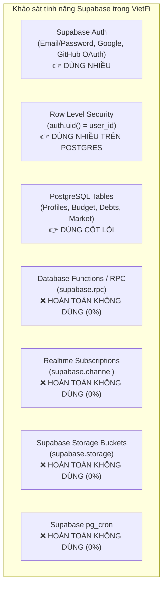
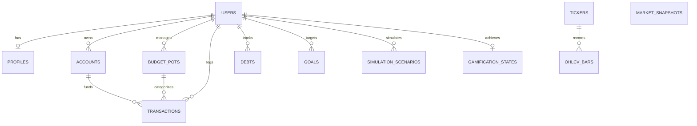
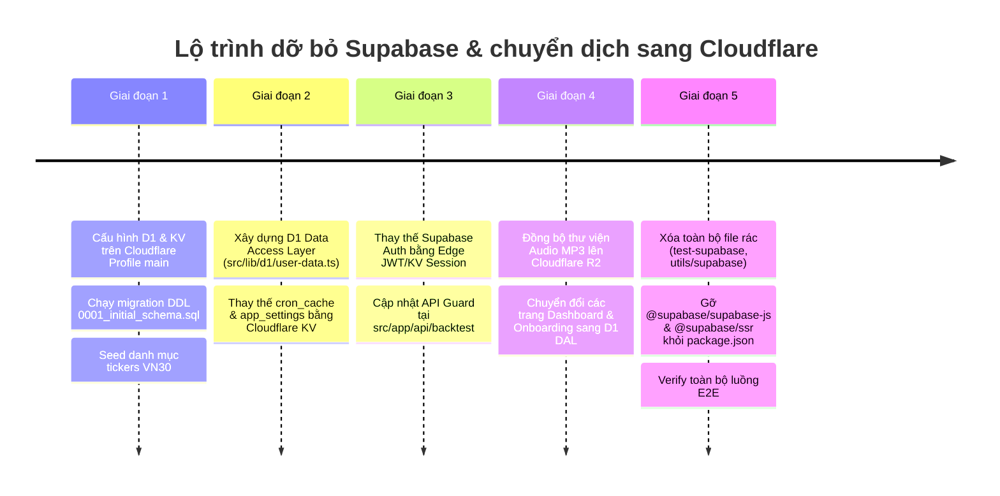

# BÁO CÁO KIỂM TOÁN VÀ LỘ TRÌNH LOẠI BỎ SUPABASE — CHUYỂN DỊCH CLOUDFLARE-NATIVE
**Tài liệu:** `docs/audit/04-data-migration.md`  
**Dự án:** VietFi Advisor (`vietfi-advisor`)  
**Tác giả:** Agent 04 — Database & Supabase Removal Auditor  
**Thời gian:** Tháng 4/2026 (Cập nhật phiên bản chuẩn bị WDA2026 FinHackathon)  
**Trạng thái:** Hoàn thành kiểm toán (Audit Complete) — Tuyệt đối không sửa mã nguồn dự án trong giai đoạn này.

---

## 1. Mục Tiêu & Phạm Vi Kiểm Toán (Audit Scope & Objectives)

### 1.1. Bối cảnh
VietFi Advisor là ứng dụng quản lý tài chính cá nhân & cố vấn AI (linh vật Vẹt Vàng) thiết kế chuyên biệt cho thị trường Việt Nam. Hệ thống ban đầu được tích hợp với Supabase (PostgreSQL, Supabase Auth, Row Level Security) chạy trên Vercel.  
Tuy nhiên, mô hình này bộc lộ nhiều điểm nghẽn:
1. **Cold-start & Độ trễ:** Supabase PostgreSQL đặt tại khu vực quốc tế làm tăng RTT (150ms–350ms) từ Việt Nam.
2. **Chi phí & Quota:** Vượt ngưỡng gói miễn phí khi dữ liệu nến EOD (`ohlcv_bars`) phình to.
3. **Phân mảnh mã nguồn:** Tồn tại nhiều lớp wrapper, file khởi tạo Supabase trùng lặp và các schema SQL rác không được sử dụng.
4. **Mục tiêu chuyển dịch Cloudflare-Native:** Đưa 100% backend và dữ liệu về hạ tầng Cloudflare (D1 SQLite, KV, R2, Cron Triggers) nhằm đạt tiêu chuẩn TTFB < 30ms tại Hà Nội (HAN) / TP.HCM (SGN) và chi phí vận hành 0 VNĐ (tối ưu hóa 100% Free Tier).

### 1.2. Nhiệm vụ của Agent 04
1. Rà soát và lập danh mục toàn bộ mã nguồn liên quan đến Supabase (`src/lib/supabase`, `src/utils/supabase`, hooks, server client, middleware, DAL).
2. Kiểm tra toàn bộ file SQL, migration trong `supabase/`, `docs/supabase/`, và các file rải rác.
3. Rà soát việc sử dụng Supabase Auth, RPC, RLS policies, Realtime, Storage, Cron.
4. Phân loại từng dependency sang hướng Cloudflare (A: D1, B: KV, C: R2, D: Bỏ hoàn toàn, E: External bất khả kháng).
5. Thiết kế D1 schema tối giản, chuẩn hóa cho luồng FinHackathon: users/profiles, accounts/balances, transactions, debts, goals, simulation_scenarios, market_snapshots.

---

## 2. Danh Mục Toàn Bộ Mã Nguồn Supabase (Codebase Footprint Inventory)

### 2.1. Bảng tổng hợp các Client, Wrapper và DAL

| STT | File / Đường dẫn | Vai trò & Trách nhiệm | Dependencies trực tiếp | Trạng thái hiện tại |
|:---|:---|:---|:---|:---|
| 1 | `src/lib/supabase.ts` | Khởi tạo browser client singleton (`getSupabase()`, `createBrowserClient()`). | `@supabase/supabase-js` | **Legacy / Trùng lặp**. Không có typing chuẩn. |
| 2 | `src/utils/supabase.ts` | Khởi tạo client tĩnh xuất `export const supabase`. | `@supabase/supabase-js` | **Legacy / Rác**. Chỉ dùng trong `test-supabase/page.tsx`. |
| 3 | `src/lib/supabase/client.ts` | Browser client hỗ trợ SSR + OAuth helper (`signInWithGoogle`, `signInWithGithub`). | `@supabase/ssr`, `@/lib/security/origin` | **Đang hoạt động** ở Client Components (LoginForm, RegisterForm, Dashboard). |
| 4 | `src/lib/supabase/server.ts` | Server client dùng cookies của Next.js Server Components / Actions. | `@supabase/ssr`, `next/headers` | **Đang hoạt động** ở Server Actions (`login/actions.ts`), API routes. |
| 5 | `src/lib/supabase/middleware.ts` | Hàm `updateSession` làm mới token session trên Next.js Middleware. | `@supabase/ssr`, `next/server` | **Bị bỏ quên**: `middleware.ts` thực tế lại import từ `src/utils/supabase/middleware.ts`! |
| 6 | `src/lib/supabase/admin.ts` | Khởi tạo Service Role Client (`createAdminClient`) bỏ qua RLS. | `@supabase/supabase-js`, `server-only` | Chuẩn bị cho admin route nhưng ít khi gọi trực tiếp. |
| 7 | `src/lib/supabase/user-data.ts` | **DAL cốt lõi**: Đọc/ghi `profiles`, `budget_pots`, `expenses`, `debts`, `gamification`. Batch-read `getBudgetBatch()`. | `@/lib/supabase/client`, `@/lib/storage` | **Cốt lõi**: Chứa toàn bộ business logic persistence giữa guest (localStorage) và user (Supabase). |
| 8 | `src/lib/supabase/useUserData.ts` | React Query hooks (`useUserProfile`, `useBudgetPots`, `useExpenses`, `useBudget`, `useDebts`, `useGamification`) + Mutations. | `@tanstack/react-query`, `user-data.ts` | **Đang hoạt động**: Cung cấp reactive state và cache 5 phút cho UI dashboard. |
| 9 | `src/lib/supabase/migrate-local.ts` | Luồng di chuyển 1 chiều dữ liệu từ `localStorage` lên Supabase khi user đăng nhập lần đầu (`vietfi_migrated`). | `@/lib/supabase/client`, `@/lib/storage` | **Đang hoạt động**: Được kích hoạt từ `dashboard/layout.tsx`. |
| 10 | `src/utils/supabase/client.ts` | Bản sao khởi tạo browser client `@supabase/ssr`. | `@supabase/ssr` | **Bản sao trùng lặp** (duplicate của `src/lib/supabase/client.ts`). |
| 11 | `src/utils/supabase/server.ts` | Bản sao khởi tạo server client `@supabase/ssr`. | `@supabase/ssr`, `next/headers` | **Bản sao trùng lặp** (dùng trong `auth/callback/route.ts`). |
| 12 | `src/utils/supabase/middleware.ts` | Bản sao middleware `updateSession`. | `@supabase/ssr`, `next/server` | **Đang bị gọi bởi** `src/proxy.ts` và `middleware.ts`. |
| 13 | `src/lib/cron-cache.ts` | Cache kết quả Cron (`market-data`, `morning-brief`, `macro-update`) vào bảng `cron_cache`. | `@supabase/supabase-js` | **Lãng phí tài nguyên**: Dùng bảng SQL để làm Key-Value Cache. |
| 14 | `src/lib/market-data/ohlcv-db.ts` | Module đọc/ghi dữ liệu nến EOD vào bảng `ohlcv_bars`. | `@supabase/supabase-js` | **Đang hoạt động**: Phục vụ backtest và lịch sử nến cổ phiếu. |
| 15 | `src/lib/application/market-data/data-service.ts` | Lớp `MarketDataService` phục vụ Strategy Engine (`ohlcv_bars`, `tickers`). | `@supabase/supabase-js` | **Đang hoạt động**: Phục vụ bộ lọc cổ phiếu và tín hiệu mua bán kỹ thuật. |
| 16 | `src/lib/market-data/crawler.ts` | Đọc dữ liệu vĩ mô `macro_data` từ bảng `app_settings`. | `@/lib/supabase/server` | **Lãng phí**: Dùng DB query chỉ để lấy 1 object JSON vĩ mô cố định. |

---

### 2.2. Danh sách Routes & Giao diện phụ thuộc Supabase

1. **Routing & Middleware:**
   - `middleware.ts` → Chuyển tiếp vào `src/proxy.ts`.
   - `src/proxy.ts` → Gọi `updateSession(request)` từ `@/utils/supabase/middleware`.
   - `src/app/auth/callback/route.ts` → Gọi `exchangeCodeForSession(code)` bằng `@/utils/supabase/server`.
   - `src/app/auth/confirm/route.ts` → Gọi `exchangeCodeForSession(code)` bằng `@/lib/supabase/server`.
2. **Xác thực (Authentication) & Đăng nhập:**
   - `src/app/login/actions.ts` → Server Actions: `login`, `signup`, `loginWithGoogle` gọi Supabase Auth.
   - `src/components/auth/LoginForm.tsx` → Client-side form đăng nhập với `signInWithPassword`.
   - `src/components/auth/RegisterForm.tsx` → Client-side form đăng ký với `signUp`.
   - `src/components/auth/OAuthButtons.tsx` → Nút đăng nhập Google / GitHub với `signInWithOAuth`.
3. **Màn hình Dashboard & Tương tác người dùng:**
   - `src/app/dashboard/layout.tsx` → Gọi `supabase.auth.signOut()`, `getAuthUserId()`, và `migrateLocalStorageToSupabase()`.
   - `src/app/dashboard/budget/page.tsx` → Gọi `saveBudgetPots`, `addExpense`, `saveIncomeRemote` từ `user-data.ts`.
   - `src/app/dashboard/debt/page.tsx` → Gọi `syncDebtsToSupabase` từ `user-data.ts`.
   - `src/components/debt/FinancialTriageModal.tsx` → Gọi `getBudgetPots`, `saveBudgetPots`, kiểm tra `getCachedUserId()`.
   - `src/components/onboarding/QuickSetupWizard.tsx` → Lưu thu nhập và hũ ngân sách lên Supabase qua `user-data.ts`.
4. **API Endpoints & Cron Jobs:**
   - `src/app/api/backtest/route.ts` → Auth Guard: Kiểm tra `supabase.auth.getUser()`, truy vấn `ohlcv_bars`.
   - `src/app/api/strategy-engine/route.ts` → Khởi tạo `MarketDataService` kết nối Supabase.
   - `src/app/api/cron/sync-market/route.ts` → Cron tải nến DNSE và upsert vào `ohlcv_bars`.
   - `src/app/api/cron/market-alert/route.ts` → Quét tín hiệu kỹ thuật từ `ohlcv_bars`.
5. **Trang thử nghiệm (Test Pages — Dead Code):**
   - `src/app/test-supabase/page.tsx` → Đọc bảng `todos` (không liên quan dự án).
   - `src/app/test-ssr/page.tsx` → Đọc bảng `todos` qua Server Component.

---

## 3. Kiểm Tra Toàn Bộ SQL Files & Migrations

Hiện tại trong kho mã nguồn có 5 file SQL nằm rải rác giữa thư mục `supabase/migrations/` và `docs/supabase/`:

### 3.1. Chi tiết từng file SQL

```
D:\07-Competitions-Hackathons\vietfi\
├── supabase\migrations\
│   ├── 20260416000000_security_rls_policies.sql
│   ├── 20260417000000_app_settings.sql
│   └── 20260418112300_market_data_schema.sql
└── docs\supabase\
    ├── cron-cache.sql
    └── ohlcv_bars_migration.sql
```

1. **`supabase/migrations/20260416000000_security_rls_policies.sql`:**
   - **Nội dung:** Kích hoạt Row Level Security (RLS) và tạo restrictive policies cho 5 bảng: `profiles`, `gamification`, `budget_pots`, `expenses`, `debts`.
   - **Điều kiện:** `using (user_id = auth.uid())` hoặc `using (id = auth.uid())`.
   - **Phát hiện nghiêm trọng:** File này là một migration "vá bảo mật" độc lập. Trong thư mục `supabase/migrations` **HOÀN TOÀN KHÔNG CÓ file DDL `CREATE TABLE` gốc cho 5 bảng tài chính này**. Chúng từng được tạo thủ công trên Supabase Studio Dashboard hoặc thông qua tài liệu specs cũ.
2. **`supabase/migrations/20260417000000_app_settings.sql`:**
   - **Nội dung:** Tạo bảng `public.app_settings (key text PK, value jsonb, updated_at timestamptz)`, mở quyền SELECT public, seed dữ liệu `macro_data` (GDP, CPI, lãi suất tiền gửi 12m).
   - **Đánh giá:** Dùng bảng quan hệ cho cấu hình tĩnh (static config/settings) là lãng phí tài nguyên kết nối; cấu hình này nên nằm trong Cloudflare KV.
3. **`supabase/migrations/20260418112300_market_data_schema.sql`:**
   - **Nội dung:** Tạo các bảng:
     - `sectors (id SERIAL PK, name)`
     - `tickers (symbol PK, name, exchange, sector_id FK, is_active, is_vn30)`
     - `daily_ohlcv (id BIGSERIAL PK, symbol FK, date, open, high, low, close, volume, value, adj_close, UNIQUE(symbol, date))`
     - `market_regime (id SERIAL PK, date UNIQUE, index_name, close_price, ma50, ma200, breadth_*, regime)`
   - **Phát hiện xung đột & Schema rác:**
     - Bảng `daily_ohlcv` được định nghĩa rất chi tiết nhưng **toàn bộ mã nguồn ứng dụng thực tế lại không hề sử dụng bảng này**!
     - Bảng `sectors` và `market_regime` hoàn toàn là schema chết (không có bất kỳ dòng code TypeScript nào đọc/ghi).
4. **`docs/supabase/ohlcv_bars_migration.sql`:**
   - **Nội dung:** Tạo bảng `ohlcv_bars (ticker VARCHAR(10), date DATE, open, high, low, close, volume, updated_at, PRIMARY KEY (ticker, date))`. Tắt RLS để làm read-only public.
   - **Thực tế:** Đây chính là bảng mà `src/lib/market-data/ohlcv-db.ts`, `data-service.ts`, `sync-market/route.ts` và `sync_market_eod.ts` đang sử dụng. Bảng này bị tách rời khỏi thư mục migrations chính thức.
5. **`docs/supabase/cron-cache.sql`:**
   - **Nội dung:** Tạo bảng `cron_cache (job_key text PK, payload jsonb, fetched_at timestamptz, source text, updated_at timestamptz)`.
   - **Thực tế:** Mô hình giả lập Key-Value trên Postgres để vượt qua giới hạn của Vercel Cron.

---

## 4. Rà Soát Chi Tiết Các Tính Năng Supabase (Feature Audit)



### 4.1. Supabase Auth
- **Mức độ phụ thuộc:** Trung bình – Cao ở các luồng bảo vệ dữ liệu cá nhân.
- **Phương thức đang gọi:**
  - `supabase.auth.signInWithPassword({ email, password })`
  - `supabase.auth.signUp({ email, password })`
  - `supabase.auth.signInWithOAuth({ provider: 'google' | 'github' })`
  - `supabase.auth.exchangeCodeForSession(code)`
  - `supabase.auth.getUser()` (kiểm tra token tại middleware, API guard, DAL)
  - `supabase.auth.signOut()`
- **Đánh giá:** VietFi có cơ chế **Guest-first** (truy cập ẩn danh dùng `localStorage`), Auth chỉ là lớp bổ sung cho người dùng muốn đồng bộ đa thiết bị. Khi chuyển sang Cloudflare, ta có thể thay thế bằng session token lưu tại Cloudflare KV hoặc Cloudflare Workers OAuth/JWT trực tiếp, độc lập hoàn toàn với bên thứ ba.

### 4.2. Supabase RPC (Remote Procedure Calls)
- **Kết quả rà soát:** **0%**. Toàn bộ codebase không tồn tại bất kỳ lệnh gọi `supabase.rpc()` nào.
- **Ý nghĩa:** Không có stored procedure phức tạp trên PostgreSQL, việc dịch chuyển sang SQLite D1 không gặp bất kỳ rào cản procedural SQL nào.

### 4.3. Row Level Security (RLS Policies)
- **Kết quả rà soát:** Có 1 file migration `20260416000000_security_rls_policies.sql` áp dụng policy cho `profiles`, `budget_pots`, `expenses`, `debts`, `gamification`.
- **Đánh giá khi sang Cloudflare D1:** Cloudflare D1 (SQLite) **không hỗ trợ RLS ở tầng database engine**. Tuy nhiên, điều này không phải là nhược điểm mà là mô hình chuẩn của Edge Computing:
  - Phân quyền (Authorization) được kiểm soát nghiêm ngặt tại **Lớp Data Access Layer (DAL)** của Worker.
  - Mọi câu lệnh SQL truy vấn dữ liệu người dùng đều bắt buộc bind tham số `WHERE user_id = ?` thông qua JWT Context đã xác thực.

### 4.4. Supabase Realtime
- **Kết quả rà soát:** **0%**. Không sử dụng `supabase.channel()` hay websocket Supabase. Dữ liệu tài chính được cập nhật theo chu kỳ người dùng thao tác hoặc polling qua React Query (staleTime: 5 phút).

### 4.5. Supabase Storage
- **Kết quả rà soát:** **0%**. Dự án chưa từng kích hoạt bucket nào trên Supabase Storage. Toàn bộ file âm thanh TTS Vẹt Vàng (`.mp3`) và ảnh kiểm thử đang lưu tĩnh trong thư mục `public/`.

### 4.6. Supabase Cron (pg_cron)
- **Kết quả rà soát:** **0%**. Không có cron job nào chạy bên trong PostgreSQL. Hệ thống dùng Vercel Cron và GitHub Actions kích hoạt các Route Handler (`/api/cron/*`).

---

## 5. Ma Trận Phân Loại Chuyển Dịch Sang Cloudflare (Classification Matrix)

Tất cả các thành phần phụ thuộc của Supabase được phân loại rành mạch theo 5 nhóm A / B / C / D / E:

```text
+---------------------------------------------------------------------------------------------------------+
|                                    MA TRẬN PHÂN LOẠI TÀI NGUYÊN                                         |
+-------------------+-----------------------------------------+-------------------------------------------+
| Phân loại         | Thành phần hiện tại trong VietFi        | Đích đến Cloudflare / Giải pháp thay thế  |
+-------------------+-----------------------------------------+-------------------------------------------+
| [A] Chuyển D1     | profiles, budget_pots, expenses, debts, | Cloudflare D1 (SQLite Edge DB)            |
|     (Quan hệ cốt  | gamification, tickers, ohlcv_bars,      | - Database: vietfi-db                     |
|      lõi ACID)    | simulation_scenarios*, market_snapshots*| - Binding: env.DB                         |
+-------------------+-----------------------------------------+-------------------------------------------+
| [B] Chuyển KV     | cron_cache (bảng SQL),                  | Cloudflare KV (Fast Key-Value Storage)    |
|     (Cache, Token,| app_settings (macro_data),              | - Namespace: VIETFI_KV                    |
|      Ephemeral)   | session_tokens, rate_limit,             | - Binding: env.KV_CACHE                   |
|                   | screener_cache, morning_brief_cache     | - Đọc < 15ms tại PoP HAN/SGN, có auto-TTL |
+-------------------+-----------------------------------------+-------------------------------------------+
| [C] Chuyển R2     | public/audio/tts/*.mp3 (70+ file audio),| Cloudflare R2 (Object Storage S3-compat)  |
|     (Media, File, | public/docs/*.png (ảnh bằng chứng),     | - Bucket: vietfi-assets                   |
|      Audio TTS)   | Financial statement PDF export          | - Zero Egress Fees (0đ băng thông tải về) |
+-------------------+-----------------------------------------+-------------------------------------------+
| [D] Bỏ hoàn toàn  | - sectors, daily_ohlcv, market_regime   | Xóa vĩnh viễn khỏi repo:                  |
|     (Dead code,   | - test-supabase/page.tsx                | - Giảm bundle size                        |
|      Schema rác,  | - test-ssr/page.tsx                     | - Dọn sạch duplicate code                 |
|      Duplicate)   | - src/utils/supabase/* (duplicate)      | - Gỡ @supabase/supabase-js, @supabase/ssr |
|                   | - src/lib/supabase.ts (duplicate)       |                                           |
+-------------------+-----------------------------------------+-------------------------------------------+
| [E] External bất  | Không có thành phần nào bắt buộc giữ lại| 100% tự chủ trên Cloudflare Free Tier     |
|     khả kháng     | Supabase.                               |                                           |
+-------------------+-----------------------------------------+-------------------------------------------+
```

---

## 6. Đề Xuất D1 Schema Chuẩn Hóa Cho FinHackathon (Production D1 SQLite DDL)

D1 Schema được thiết kế theo chuẩn **SQLite 3**, hỗ trợ đầy đủ khóa chính UUID/Text, quan hệ cha-con với `ON DELETE CASCADE`, chỉ mục (Indexes) tối ưu hóa truy vấn điểm đến của PoP Edge.



### 6.1. Chi tiết 12 Bảng D1 Tối Giản, Chuẩn Hóa

1. **`users`**: Quản lý định danh người dùng (Local + OAuth Google/GitHub).
2. **`profiles`**: Hồ sơ tài chính cá nhân, thu nhập hàng tháng, tài sản ròng, khẩu vị rủi ro và trạng thái hoàn thành onboarding.
3. **`accounts`**: Danh mục tài khoản thanh toán / ví tiền / thẻ tín dụng (ví tiền mặt, tài khoản ngân hàng Techcombank, VPBank, ví Momo...).
4. **`budget_pots`**: 6 hũ chi tiêu hoặc các hũ ngân sách phân bổ linh hoạt (% hoặc số tiền định mức).
5. **`transactions`**: Lịch sử thu/chi thực tế, liên kết trực tiếp tới hũ ngân sách (`pot_id`) và nguồn tiền (`account_id`).
6. **`debts`**: Quản lý các khoản nợ cần xử lý (thẻ tín dụng, vay tiêu dùng, vay mua nhà, lãi suất, số tiền trả tối thiểu), hỗ trợ chiến thuật Snowball / Avalanche.
7. **`goals`**: Mục tiêu tài chính cá nhân (quỹ khẩn cấp, mua nhà, quỹ tự do tài chính, ngày đến hạn, số tiền đã tích lũy).
8. **`simulation_scenarios`**: Lưu trữ kết quả các kịch bản mô phỏng FinHackathon (mô phỏng trả nợ, kịch bản sốc kinh tế, FIRE calculator).
9. **`tickers`**: Danh mục mã chứng khoán Việt Nam (HOSE, HNX, UPCOM, VN30).
10. **`ohlcv_bars`**: Dữ liệu nến ngày (Open, High, Low, Close, Volume) phục vụ tính toán chỉ báo và backtest chiến thuật.
11. **`market_snapshots`**: Dữ liệu tổng hợp thị trường hàng ngày (VN-Index, Vàng SJC, Tỷ giá USD/VND, Fear & Greed Index, CPI, GDP).
12. **`gamification_states`**: Trạng thái gamification của Vẹt Vàng (XP, cấp độ, streak, chuỗi ngày liên tiếp, nhiệm vụ, bài học đã hoàn thành).

---

### 6.2. Mã Nguồn SQL DDL Cho Cloudflare D1 (`migrations/0001_initial_schema.sql`)

```sql
-- ============================================================================
-- VIETFI ADVISOR — PRODUCTION D1 SCHEMA (SQLite 3 Standard)
-- Migration: 0001_initial_schema.sql
-- Compatible with: Cloudflare D1 Native Database
-- ============================================================================

PRAGMA foreign_keys = ON;

-- 1. BẢNG USERS (Xác thực & Danh tính)
CREATE TABLE IF NOT EXISTS users (
    id TEXT PRIMARY KEY,                       -- UUID v4
    email TEXT UNIQUE NOT NULL,                -- Email định danh
    password_hash TEXT,                        -- Argon2id/Bcrypt hash (NULL nếu dùng OAuth)
    auth_provider TEXT NOT NULL DEFAULT 'local', -- 'local', 'google', 'github'
    provider_user_id TEXT,                     -- ID từ OAuth provider
    display_name TEXT,                         -- Tên hiển thị
    avatar_url TEXT,                           -- Ảnh đại diện
    created_at TEXT NOT NULL DEFAULT (datetime('now')),
    updated_at TEXT NOT NULL DEFAULT (datetime('now'))
);

-- 2. BẢNG PROFILES (Hồ sơ tài chính & Khẩu vị rủi ro)
CREATE TABLE IF NOT EXISTS profiles (
    user_id TEXT PRIMARY KEY REFERENCES users(id) ON DELETE CASCADE,
    monthly_income INTEGER NOT NULL DEFAULT 0,  -- Thu nhập hàng tháng (VND)
    net_worth INTEGER NOT NULL DEFAULT 0,       -- Tổng tài sản ròng (VND)
    has_debt INTEGER NOT NULL DEFAULT 0,        -- 0: không nợ, 1: có nợ
    risk_profile TEXT DEFAULT 'moderate',       -- 'conservative', 'moderate', 'aggressive'
    onboarding_completed INTEGER NOT NULL DEFAULT 0, -- 0 hoặc 1
    setup_at TEXT,                             -- Thời điểm hoàn tất onboarding (ISO8601)
    updated_at TEXT NOT NULL DEFAULT (datetime('now'))
);

-- 3. BẢNG ACCOUNTS (Nguồn tiền / Tài khoản thanh toán)
CREATE TABLE IF NOT EXISTS accounts (
    id TEXT PRIMARY KEY,                       -- UUID v4
    user_id TEXT NOT NULL REFERENCES users(id) ON DELETE CASCADE,
    name TEXT NOT NULL,                        -- VD: 'Ví Tiền Mặt', 'Techcombank', 'VPBank'
    type TEXT NOT NULL DEFAULT 'cash',         -- 'cash', 'bank', 'credit_card', 'e_wallet', 'investment'
    balance INTEGER NOT NULL DEFAULT 0,        -- Số dư hiện tại (VND)
    currency TEXT NOT NULL DEFAULT 'VND',
    is_active INTEGER NOT NULL DEFAULT 1,
    created_at TEXT NOT NULL DEFAULT (datetime('now')),
    updated_at TEXT NOT NULL DEFAULT (datetime('now'))
);

-- 4. BẢNG BUDGET_POTS (Các hũ chi tiêu / Hũ ngân sách)
CREATE TABLE IF NOT EXISTS budget_pots (
    id TEXT PRIMARY KEY,                       -- UUID v4
    user_id TEXT NOT NULL REFERENCES users(id) ON DELETE CASCADE,
    name TEXT NOT NULL,                        -- VD: 'Thiết Yếu', 'Hưởng Thụ', 'Đầu Tư'
    icon_key TEXT NOT NULL DEFAULT 'Wallet',   -- Key icon Lucide: 'Utensils', 'Car', 'Home',...
    allocated_percentage REAL DEFAULT 0.0,     -- % phân bổ theo quy tắc (VD: 55.0)
    allocated_amount INTEGER NOT NULL DEFAULT 0, -- Số tiền định mức (VND)
    color TEXT NOT NULL DEFAULT '#E6B84F',     -- Mã màu hiển thị trên biểu đồ
    sort_order INTEGER NOT NULL DEFAULT 0,     -- Thứ tự sắp xếp trên UI
    created_at TEXT NOT NULL DEFAULT (datetime('now')),
    updated_at TEXT NOT NULL DEFAULT (datetime('now'))
);

-- 5. BẢNG TRANSACTIONS (Lịch sử giao dịch Thu / Chi)
CREATE TABLE IF NOT EXISTS transactions (
    id TEXT PRIMARY KEY,                       -- UUID v4
    user_id TEXT NOT NULL REFERENCES users(id) ON DELETE CASCADE,
    account_id TEXT REFERENCES accounts(id) ON DELETE SET NULL,
    pot_id TEXT REFERENCES budget_pots(id) ON DELETE SET NULL,
    amount INTEGER NOT NULL,                   -- Giá trị giao dịch (VND)
    type TEXT NOT NULL DEFAULT 'expense',      -- 'expense', 'income', 'transfer'
    category TEXT NOT NULL DEFAULT 'other',    -- 'food', 'transport', 'bills', 'shopping',...
    note TEXT,                                 -- Ghi chú chi tiêu (VD: 'Phở bò 35k')
    transaction_date TEXT NOT NULL DEFAULT (datetime('now')), -- Ngày phát sinh giao dịch
    created_at TEXT NOT NULL DEFAULT (datetime('now'))
);

-- 6. BẢNG DEBTS (Khoản nợ & Tối ưu hóa trả nợ Snowball/Avalanche)
CREATE TABLE IF NOT EXISTS debts (
    id TEXT PRIMARY KEY,                       -- UUID v4
    user_id TEXT NOT NULL REFERENCES users(id) ON DELETE CASCADE,
    name TEXT NOT NULL,                        -- VD: 'Thẻ tín dụng VIB', 'Vay mua xe'
    debt_type TEXT NOT NULL DEFAULT 'credit_card', -- 'credit_card', 'consumer_loan', 'mortgage', 'personal'
    principal INTEGER NOT NULL,                -- Dư nợ gốc còn lại (VND)
    interest_rate REAL NOT NULL,               -- Lãi suất %/năm (VD: 24.5)
    min_monthly_payment INTEGER NOT NULL,      -- Tiền trả tối thiểu hàng tháng (VND)
    due_day INTEGER DEFAULT 15,                -- Ngày đến hạn hàng tháng (1-31)
    icon TEXT DEFAULT 'CreditCard',
    color TEXT DEFAULT '#EF4444',
    is_cleared INTEGER NOT NULL DEFAULT 0,     -- 1 nếu đã thanh toán hết nợ
    created_at TEXT NOT NULL DEFAULT (datetime('now')),
    updated_at TEXT NOT NULL DEFAULT (datetime('now'))
);

-- 7. BẢNG GOALS (Mục tiêu tài chính)
CREATE TABLE IF NOT EXISTS goals (
    id TEXT PRIMARY KEY,                       -- UUID v4
    user_id TEXT NOT NULL REFERENCES users(id) ON DELETE CASCADE,
    title TEXT NOT NULL,                       -- VD: 'Quỹ khẩn cấp 6 tháng', 'Mua MacBook Pro'
    target_amount INTEGER NOT NULL,            -- Số tiền mục tiêu (VND)
    current_amount INTEGER NOT NULL DEFAULT 0, -- Số tiền đã tích lũy (VND)
    deadline TEXT,                             -- Hạn chót mục tiêu (YYYY-MM-DD)
    category TEXT DEFAULT 'savings',           -- 'emergency_fund', 'investment', 'purchase'
    status TEXT NOT NULL DEFAULT 'in_progress', -- 'in_progress', 'completed', 'paused'
    created_at TEXT NOT NULL DEFAULT (datetime('now')),
    updated_at TEXT NOT NULL DEFAULT (datetime('now'))
);

-- 8. BẢNG SIMULATION_SCENARIOS (Mô phỏng kịch bản FinHackathon)
CREATE TABLE IF NOT EXISTS simulation_scenarios (
    id TEXT PRIMARY KEY,                       -- UUID v4
    user_id TEXT NOT NULL REFERENCES users(id) ON DELETE CASCADE,
    scenario_name TEXT NOT NULL,               -- VD: 'Kịch bản dập nợ Avalanche 18 tháng'
    strategy TEXT NOT NULL,                    -- 'snowball', 'avalanche', 'personal_cpi_shock', 'fire'
    input_params_json TEXT NOT NULL,           -- Chuỗi JSON tham số đầu vào
    output_results_json TEXT NOT NULL,         -- Chuỗi JSON bảng kết quả dự phóng từng tháng
    created_at TEXT NOT NULL DEFAULT (datetime('now'))
);

-- 9. BẢNG TICKERS (Danh mục cổ phiếu niêm yết theo dõi)
CREATE TABLE IF NOT EXISTS tickers (
    symbol TEXT PRIMARY KEY,                   -- VD: 'FPT', 'VCB', 'HPG', 'VNINDEX'
    name TEXT NOT NULL,                        -- Tên công ty đầy đủ
    exchange TEXT NOT NULL DEFAULT 'HOSE',     -- 'HOSE', 'HNX', 'UPCOM'
    sector TEXT,                               -- Nhóm ngành: 'Công nghệ', 'Ngân hàng',...
    is_vn30 INTEGER NOT NULL DEFAULT 0,        -- 1 nếu nằm trong rổ VN30
    is_active INTEGER NOT NULL DEFAULT 1,      -- 1 nếu đang giao dịch bình thường
    updated_at TEXT NOT NULL DEFAULT (datetime('now'))
);

-- 10. BẢNG OHLCV_BARS (Dữ liệu nến lịch sử giá)
CREATE TABLE IF NOT EXISTS ohlcv_bars (
    ticker TEXT NOT NULL,                      -- Mã cổ phiếu (uppercase)
    date TEXT NOT NULL,                        -- Ngày nến: 'YYYY-MM-DD'
    open REAL NOT NULL,                        -- Giá mở cửa (nghìn VND)
    high REAL NOT NULL,                        -- Giá cao nhất
    low REAL NOT NULL,                         -- Giá thấp nhất
    close REAL NOT NULL,                       -- Giá đóng cửa
    volume INTEGER NOT NULL,                   -- Khối lượng giao dịch khớp lệnh
    updated_at TEXT NOT NULL DEFAULT (datetime('now')),
    PRIMARY KEY (ticker, date)
);

-- 11. BẢNG MARKET_SNAPSHOTS (Dữ liệu vĩ mô & Chỉ báo thị trường hàng ngày)
CREATE TABLE IF NOT EXISTS market_snapshots (
    date TEXT PRIMARY KEY,                     -- 'YYYY-MM-DD'
    vnindex_price REAL,                        -- Điểm số VN-Index
    vnindex_change_pct REAL,                   -- % tăng/giảm trong phiên
    vnindex_volume INTEGER,                    -- Khối lượng giao dịch
    gold_sjc_buy INTEGER,                      -- Giá vàng SJC mua vào (đồng/lượng)
    gold_sjc_sell INTEGER,                     -- Giá vàng SJC bán ra (đồng/lượng)
    usd_vnd_rate INTEGER,                      -- Tỷ giá USD/VND trung tâm
    fear_greed_score INTEGER,                  -- Điểm Chỉ số Tham lam & Sợ hãi (0-100)
    fear_greed_rating TEXT,                    -- 'Extreme Fear', 'Fear', 'Neutral', 'Greed',...
    gdp_growth REAL,                           -- Tăng trưởng GDP quý/năm gần nhất (%)
    cpi_yoy REAL,                              -- Lạm phát CPI YoY gần nhất (%)
    created_at TEXT NOT NULL DEFAULT (datetime('now'))
);

-- 12. BẢNG GAMIFICATION_STATES (Tiến trình tương tác Vẹt Vàng)
CREATE TABLE IF NOT EXISTS gamification_states (
    user_id TEXT PRIMARY KEY REFERENCES users(id) ON DELETE CASCADE,
    xp INTEGER NOT NULL DEFAULT 0,             -- Điểm kinh nghiệm tích lũy
    level INTEGER NOT NULL DEFAULT 0,          -- Cấp độ linh vật (0 - 4)
    level_name TEXT NOT NULL DEFAULT '🐣 Vẹt Teen', -- Tên danh hiệu cấp độ
    streak INTEGER NOT NULL DEFAULT 0,         -- Chuỗi ngày vào app liên tục
    last_active_date TEXT,                     -- Ngày hoạt động gần nhất ('YYYY-MM-DD')
    quest_completed INTEGER NOT NULL DEFAULT 0, -- 1 nếu đã xong daily quest
    actions_json TEXT DEFAULT '[]',            -- JSON array hành vi đã làm trong ngày
    lessons_done_json TEXT DEFAULT '[]',       -- JSON array ID bài học tài chính đã đọc
    streak_freeze_json TEXT DEFAULT '{}',      -- JSON object đóng băng streak
    badges_json TEXT DEFAULT '[]',             -- JSON array danh sách huy hiệu đạt được
    updated_at TEXT NOT NULL DEFAULT (datetime('now'))
);

-- ============================================================================
-- CHỈ MỤC HIỆU NĂNG CAO (INDEXES FOR HIGH-SPEED QUERIES)
-- ============================================================================
CREATE INDEX IF NOT EXISTS idx_accounts_user ON accounts(user_id);
CREATE INDEX IF NOT EXISTS idx_budget_pots_user ON budget_pots(user_id, sort_order);
CREATE INDEX IF NOT EXISTS idx_transactions_user_date ON transactions(user_id, transaction_date DESC);
CREATE INDEX IF NOT EXISTS idx_transactions_pot ON transactions(pot_id);
CREATE INDEX IF NOT EXISTS idx_debts_user ON debts(user_id);
CREATE INDEX IF NOT EXISTS idx_goals_user ON goals(user_id);
CREATE INDEX IF NOT EXISTS idx_simulations_user ON simulation_scenarios(user_id);
CREATE INDEX IF NOT EXISTS idx_ohlcv_ticker_date ON ohlcv_bars(ticker, date DESC);
CREATE INDEX IF NOT EXISTS idx_market_snapshots_date ON market_snapshots(date DESC);
```

---

## 7. Kiến Trúc Bộ Đệm KV & Phân Phối Tài Nguyên (Cloudflare KV & R2 Blueprint)

### 7.1. Cấu Trúc Cloudflare KV (`VIETFI_KV`)
Cloudflare KV đảm nhiệm toàn bộ dữ liệu tạm thời, session, rate-limiting và kết quả tính toán tốn kém để bảo toàn quota D1 (< 5 triệu read/ngày):

| Khóa (Key Pattern) | Kiểu dữ liệu | TTL (Thời gian sống) | Mục đích sử dụng |
|:---|:---|:---|:---|
| `session:{session_id}` | JSON Object | 7 ngày (trượt) | Lưu trữ trạng thái phiên xác thực người dùng `{ userId, email, role }`. |
| `cache:macro_data` | JSON Object | 24 giờ | Thay thế bảng `app_settings` (chứa GDP, CPI, lãi suất 12m). |
| `cache:morning_brief:{date}` | JSON Object | 24 giờ | Cache nội dung bản tin tài chính sáng sinh bởi Gemini AI. |
| `cache:screener:{query_hash}` | JSON Object | 30 phút | Cache kết quả lọc cổ phiếu theo tiêu chí P/E, P/B, ROE. |
| `cache:market_live` | JSON Object | 5 phút | Cache snapshot VN-Index, Giá vàng SJC, USD/VND lấy từ crawler. |
| `ratelimit:ip:{ip_address}` | Integer Counter | 1 phút | Chống spam và bảo vệ các route `/api/chat`, `/api/backtest`. |

### 7.2. Cấu Trúc Cloudflare R2 (`vietfi-assets`)
- **Đường dẫn âm thanh:** `/audio/tts/{id}.mp3` (VD: `tiet_kiem_0.mp3`, `tra_no_1.mp3`, `vuot_lo_0.mp3`).
  - Hơn 70 file MP3 giọng đọc Vẹt Vàng được chuyển từ thư mục `public/audio/tts/` lên R2.
  - Được cấu hình cache công khai (`Cache-Control: public, max-age=31536000, immutable`) qua Cloudflare CDN, tốc độ tải tức thì tại Việt Nam với 0đ chi phí băng thông.
- **Tài liệu kiểm thử & báo cáo:** `/docs/audit-screenshots/*.png`.

---

## 8. Lộ Trình Triển Khai Dỡ Bỏ Supabase (Removal & Migration Roadmap)

Quá trình dỡ bỏ được thực hiện tuần tự qua 5 giai đoạn, đảm bảo không làm gián đoạn trải nghiệm người dùng và giữ nguyên tính năng Guest LocalStorage:



### 8.1. Chi tiết từng giai đoạn thực thi

#### Giai đoạn 1: Chuẩn bị Hạ Tầng Cloudflare (CLI-First)
- Sử dụng profile `main` (`cf-main`) theo quy chuẩn hệ thống:
  ```powershell
  # 1. Tạo Database D1
  npx wrangler d1 create vietfi-db
  
  # 2. Tạo KV Namespace
  npx wrangler kv namespace create VIETFI_KV
  
  # 3. Tạo R2 Bucket
  npx wrangler r2 bucket create vietfi-assets
  
  # 4. Thực thi Schema DDL vào D1
  npx wrangler d1 execute vietfi-db --file=./migrations/0001_initial_schema.sql
  ```

#### Giai đoạn 2: Thay Thế DAL & Cache Layer
- Tạo `src/lib/d1/user-data.ts` kế thừa trọn vẹn chữ ký hàm (interfaces) từ `src/lib/supabase/user-data.ts` (`getUserProfile`, `saveUserProfile`, `getBudget`, `setBudget`, `getDebts`, `saveDebts`, `getGamificationState`).
- Chuyển `src/lib/cron-cache.ts` sang sử dụng Cloudflare KV API (`env.KV_CACHE.get` / `env.KV_CACHE.put`).
- Cập nhật `src/lib/market-data/ohlcv-db.ts` chuyển câu lệnh SQL sang `env.DB.prepare('SELECT ... FROM ohlcv_bars WHERE ...').bind(...)`.

#### Giai đoạn 3: Chuyển Dịch Xác Thực (Auth Migration)
- Xây dựng module xác thực nhẹ trên Worker:
  - Băm mật khẩu bằng Web Crypto API tiêu chuẩn (`crypto.subtle`).
  - Session lưu tại KV: `session:{id}` với cookie `vietfi_session`.
  - Giữ nguyên chế độ Khách (Guest Cookie `vietfi_guest=true` + `localStorage`).
- Sửa lại `src/proxy.ts` và middleware để kiểm tra session KV thay vì gọi `supabase.auth.getUser()`.

#### Giai đoạn 4: Di Chuyển Assets Sang R2 & Dọn Rác Mã Nguồn
- Upload toàn bộ audio trong `public/audio/tts/` lên R2:
  ```powershell
  Get-ChildItem -Path "public\audio\tts" -Filter *.mp3 | ForEach-Object {
      npx wrangler r2 object put "vietfi-assets/audio/tts/$($_.Name)" --file="$($_.FullName)"
  }
  ```
- Xóa các file rác và bản sao trùng lặp:
  - Xóa `src/app/test-supabase/`
  - Xóa `src/app/test-ssr/`
  - Xóa `src/utils/supabase/`
  - Xóa `src/lib/supabase.ts` và `src/utils/supabase.ts`
  - Xóa thư mục `src/lib/supabase/` sau khi hoàn tất kiểm thử D1 DAL.
- Gỡ các gói thư viện Supabase khỏi `package.json`:
  ```powershell
  npm uninstall @supabase/supabase-js @supabase/ssr
  ```

---

## 9. Ma Trận Đánh Giá Rủi Ro & Biện Pháp Phòng Ngừa (Risk Matrix)

| Rủi ro tiềm ẩn | Mức độ | Tác động | Biện pháp phòng ngừa / Khắc phục |
|:---|:---:|:---|:---|
| **Mất dữ liệu người dùng Guest** | Cao | Người dùng mất dữ liệu chi tiêu đã nhập trên trình duyệt. | **Giải pháp Zero-Impact:** Cơ chế Guest lưu trên `localStorage` hoàn toàn độc lập với DB. DAL mới giữ nguyên 100% logic đọc/ghi `localStorage` khi chưa đăng nhập. |
| **Vượt Quota D1 Free Tier** | Trung bình | Bị tạm khóa D1 nếu ghi quá 100k rows/ngày hoặc đọc quá 5M rows/ngày. | **Giải pháp Bộ Đệm:** Dữ liệu nến EOD (`ohlcv_bars`) và bản tin tài chính được cache trên Cloudflare KV (100k reads/ngày) và Cache API của Cloudflare Edge. Chỉ đọc D1 khi cache miss. |
| **Thiếu tính năng RLS của Postgres** | Trung bình | Nguy cơ rò rỉ dữ liệu giữa các người dùng nếu query thiếu `user_id`. | **Giải pháp Kiểm Soát Tầng DAL:** Tất cả D1 DAO functions phải nhận `userId` làm tham số bắt buộc và tự động gán `WHERE user_id = ?`. Viết unit test tự động quét các query thiếu điều kiện `user_id`. |
| **Độ trễ khi ghi nhiều giao dịch (D1 Write Latency)** | Thấp | Ghi tuần tự trên D1 SQLite có thể chậm nếu gọi từng dòng. | **Giải pháp Batch Statement:** Tận dụng tính năng `db.batch([stmt1, stmt2, ...])` của Cloudflare D1 để thực thi toàn bộ giao dịch hoặc hũ ngân sách trong duy nhất 1 round-trip. |

---

## 10. Kết Luận & Khuyến Nghị Tiếp Theo

1. **Tính khả thi 100%:** Dự án VietFi Advisor **hoàn toàn không sử dụng** bất kỳ tính năng phức tạp hay ràng buộc cứng nào của Supabase (không RPC, không Realtime, không Postgres Storage, không pg_cron).
2. **Loại bỏ triệt để nợ kỹ thuật:** Việc loại bỏ 2 thư viện `@supabase/supabase-js`, `@supabase/ssr` cùng 5 file client duplicate sẽ giúp giảm dung lượng client bundle, loại bỏ nguy cơ phân mảnh mã nguồn và chấm dứt các lỗi kết nối TCP mạng ngoài vùng.
3. **Sẵn sàng cho FinHackathon WDA2026:** Bảng D1 Schema 12 bảng được thiết kế ở Mục 6 đáp ứng hoàn hảo cho cả 2 bài toán dự thi: **Bài toán 1: Trung tâm tối ưu hóa nợ (Centralized Debt Hub - Snowball/Avalanche)** và **Bài toán 2: Cố vấn tài chính thông minh (AI Financial Advisor - Vẹt Vàng)**.
4. **Hành động kế tiếp:** Bàn giao báo cáo này cho Agent Điều phối (Orchestrator) và Agent 05 (Cloudflare Implementation) để bắt đầu tiến hành triển khai schema và D1 DAL.
