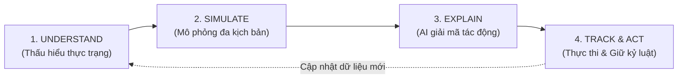

# VIETFI ADVISOR — PRODUCT STORY & DEMO STRATEGY
## BẢNG CHIẾN LƯỢC ĐỊNH VỊ SẢN PHẨM & KỊCH BẢN DEMO FINHACKATHON

> **Mã chiến lược:** `FINHACK-2026-DECISION-SIM`  
> **Phiên bản:** 1.0.0 (SSOT Product Documentation)  
> **Tác giả:** Agent 10 — FINHACKATHON Product Story & Demo Strategist  
> **Áp dụng cho:** Đội ngũ VietFi Advisor (Hackathon Finals & Pitch Deck)  
> **Tuyên ngôn cốt lõi:** *"Không phải gương chiếu hậu ghi chép việc đã rồi — VietFi là kính chắn gió mô phỏng tương lai tài chính trước mỗi quyết định xuống tiền."*

---

## MỤC LỤC
1. [Executive Summary & Tuyên Ngôn Định Vị Mới](#1-executive-summary--tuyen-ngon-dinh-vi-moi)
2. [Bối Cảnh & Điểm Đau Cốt Lõi Của Người Trẻ Việt](#2-boi-canh--diem-dau-cot-loi-cua-nguoi-tre-viet)
3. [Sự Chuyển Dịch Tư Duy: Vì Sao "AI Chatbot Nhiều Tính Năng" Sẽ Thất Bại](#3-su-chuyen-dich-tu-duy-vi-sao-ai-chatbot-nhieu-tinh-nang-se-that-bai)
4. [Mô Hình Khung U-S-E-T (Core Product Framework)](#4-mo-hinh-khung-u-s-e-t-core-product-framework)
5. [Kịch Bản Demo Pitching < 3 Phút (Chi Tiết Từng Giây & Từng Màn Hình)](#5-kich-ban-demo-pitching--3-phut)
   - [00:00 - 00:25 | Hook & Đặt Vấn Đề](#hook--dat-van-de-25-giay)
   - [00:25 - 00:55 | Screen 01: Onboarding Cực Tốc (Quick Intake)](#screen-01-onboarding-cuc-toc-quick-intake)
   - [00:55 - 01:25 | Screen 02: Financial Dashboard (Tổng Quan Sức Khỏe)](#screen-02-financial-dashboard-tong-quan-suc-khoe)
   - [01:25 - 01:55 | Screen 03: Financial Health Check (Chẩn Đoán Điểm Nghẽn)](#screen-03-financial-health-check-chan-doan-diem-nghen)
   - [01:55 - 02:30 | Screen 04: Decision Simulator (Hero Feature: Mua Laptop 25 Triệu)](#screen-04-decision-simulator-hero-feature-mua-laptop-25-trieu)
   - [02:30 - 02:55 | Screen 05: AI Explanation & Action Plan (Phán Quyết Vẹt Vàng)](#screen-05-ai-explanation--action-plan-phan-quyet-vet-vang)
   - [02:55 - 03:00 | Outro & Closing Statement](#outro--closing-statement-5-giay)
6. [Tái Cấu Trúc Navigation: Giữ Gì & Ẩn Gì Trong Demo](#6-tai-cau-truc-navigation-giu-gi--an-gi-trong-demo)
7. [Bảng Ma Trận So Sánh Cạnh Tranh (Competitive Moat)](#7-bang-ma-tran-so-sanh-canh-tranh-competitive-moat)
8. [Thông Số Kỹ Thuật Đằng Sau Kịch Bản Demo (Engine Data Spec)](#8-thong-so-ky-thuat-dang-sau-kich-ban-demo-engine-data-spec)

---

## 1. Executive Summary & Tuyên Ngôn Định Vị Mới

### 1.1. Tuyên ngôn định vị (Product Positioning Statement)
- **Tên sản phẩm:** VietFi Advisor (Phiên bản FINHACKATHON)
- **Tagline:** *"Thấy trước tương lai tài chính trước khi quẹt thẻ"* (The Financial Decision Impact Simulator)
- **Định vị mới:** VietFi không phải là ứng dụng ghi chép chi tiêu, cũng không phải là chatbot hỏi đáp tài chính tổng quát. **VietFi là Hệ thống Mô phỏng Tác động Quyết định Tài chính (Financial Decision Impact Simulator) đầu tiên tại Việt Nam**, giúp người trẻ Gen Z & Millennials "nhìn thấy trước tương lai" của dòng tiền, quỹ khẩn cấp và áp lực nợ nần TRƯỚC KHI thực hiện các quyết định mua sắm lớn, vay nợ trả góp hay đầu tư.

### 1.2. Giá trị cốt lõi giải quyết bài toán thật
| Khía cạnh | Cách tiếp cận cũ (Thị trường) | Giải pháp đột phá của VietFi |
| :--- | :--- | :--- |
| **Góc nhìn thời gian** | **Gương chiếu hậu (Rearview Mirror):** Thống kê việc đã rồi ("Tháng này bạn đã tiêu lố 3 triệu"). | **Kính chắn gió (Windshield Simulator):** Mô phỏng trước tương lai ("Nếu bạn mua laptop 25tr trả góp, dòng tiền tự do tháng tới sẽ về 0 và nguy cơ vỡ nợ tăng 85%"). |
| **Vai trò của AI** | **Chatbot đối thoại chung chung:** Trả lời định nghĩa lãi kép, khuyên tiết kiệm sáo rỗng. | **Cố vấn hành vi sắc lẹm (Actionable Engine):** Bóc trần phí ẩn BNPL/thẻ tín dụng, tính toán chính xác số tháng tự do tài chính bị hoãn lại, đề xuất giải pháp thay thế cụ thể. |
| **Tâm lý người dùng** | Cảm giác tội lỗi sau khi tiêu tiền vô tội vạ. | Tự tin và chủ động kiểm soát vận mệnh tài chính nhờ dữ liệu mô phỏng rõ ràng. |

---

## 2. Bối Cảnh & Điểm Đau Cốt Lõi Của Người Trẻ Việt

### 2.1. Bối cảnh số hóa và cạm bẫy tài chính hiện đại
Tại Việt Nam năm 2025–2026:
- Thanh toán không dùng tiền mặt và mua sắm thương mại điện tử đạt đỉnh cao.
- Sản phẩm tài chính vi mô như **Mua trước trả sau (BNPL - SPayLater, Kredivo, Home PayLater)** và **Thẻ tín dụng hoàn tiền** tiếp cận ồ ạt người trẻ từ lúc mới ra trường.
- Người trẻ có thu nhập trung bình 10–25 triệu VND/tháng nhưng thường sở hữu từ 2 đến 4 nghĩa vụ nợ nhỏ lẻ không được thống kê tập trung.

### 2.2. Điểm đau cốt lõi: "Mù hiệu ứng cánh bướm tài chính" (Financial Blindspot)
Khi đứng trước quyết định mua một món đồ lớn (Laptop 25 triệu, iPhone mới 30 triệu, xe máy SH 80 triệu, chuyến du lịch 15 triệu):
1. **Ảo giác số tiền nhỏ (Mental Accounting Bias):** Chia nhỏ 25 triệu thành 2.2 triệu/tháng trả góp khiến người trẻ lầm tưởng món đồ "quá rẻ" và nằm trong tầm tay.
2. **Không thấy được sự tàn phá quỹ khẩn cấp:** Một quyết định trả thẳng hoặc đặt cọc lớn có thể rút cạn 100% quỹ dự phòng khẩn cấp mà người đó tích lũy cả năm trời.
3. **Mất đứt dòng tiền tự do (Free Cashflow Squeeze):** Khi các khoản trả góp cộng dồn vào hóa đơn sinh hoạt, chỉ cần một cú sốc nhỏ (ốm đau, hỏng xe, công ty chậm lương 5 ngày), người trẻ lập tức rơi vào vòng xoáy nợ mới trả nợ cũ với lãi suất thực 25%–60%/năm.

---

## 3. Sự Chuyển Dịch Tư Duy: Vì Sao "AI Chatbot Nhiều Tính Năng" Sẽ Thất Bại

### 3.1. Nghịch lý của các sản phẩm "Siêu App Tài Chính"
Nhiều đội thi Hackathon thường mắc bẫy "nhồi nhét tính năng":
- Ghi chép chi tiêu từng ly từng tí (Data entry fatigue $\rightarrow$ 90% người dùng bỏ sau 7 ngày).
- Tích hợp tin tức chứng khoán, lọc cổ phiếu, backtest nến kỹ thuật (Rời xa nhóm người dùng phổ thông, cạnh tranh vô vọng với TCBS, SSI, FireAnt).
- Nhúng một khung Chatbot OpenAI/Gemini hỏi gì đáp nấy (Khách hàng không bao giờ mở app chỉ để chat hỏi "Lãi kép là gì?").

### 3.2. Tư duy thiết kế sản phẩm chiến thắng tại FINHACKATHON
> **"Chiến thắng không thuộc về người làm nhiều tính năng nhất, mà thuộc về người giải quyết dứt điểm một khoảnh khắc quyết định (Decision Moment) quan trọng nhất của người dùng."**

VietFi Advisor cô đọng toàn bộ sức mạnh công nghệ (DTI Calculator, Snowball Optimizer, Cashflow Engine, Gemini AI) vào **một đòn bẩy duy nhất: GIẢI MÃ QUYẾT ĐỊNH TÀI CHÍNH**.

```
[QUÁ KHỨ]              [HIỆN TẠI]                        [TƯƠNG LAI]
MoneyLover/Excel  -->  VietFi Health Check   -->   VietFi Decision Simulator
(Đã tiêu gì?)          (Sức khỏe đang ở đâu?)      (Nếu chi khoản này, ngày mai sẽ ra sao?)
```

---

## 4. Mô Hình Khung U-S-E-T (Core Product Framework)

Toàn bộ trải nghiệm của VietFi vận hành theo chu trình 4 bước chuẩn xác:



### 1. UNDERSTAND (Thấu hiểu thực trạng trong 30 giây)
- Không bắt người dùng nhập 100 giao dịch quá khứ.
- Thu thập đúng 4 tham số vàng: **Thu nhập hàng tháng**, **Chi phí cố định**, **Danh mục nợ hiện tại**, **Quỹ dự phòng đang có**.
- Tự động lượng hóa thành:
  - **Tỷ lệ nợ trên thu nhập (DTI Ratio)**.
  - **Dung lượng Quỹ Khẩn Cấp (Emergency Runway tính theo tháng)**.
  - **Dòng tiền tự do ròng (Monthly Free Cashflow)**.

### 2. SIMULATE (Mô phỏng đa kịch bản trước khi xuống tiền)
- Người dùng nhập ý định: *Mua laptop 25.000.000 đ*.
- Hệ thống lập tức chạy mô phỏng đối chiếu **BEFORE vs AFTER** trên 3 phương án:
  - **Phương án 1 (Trả thẳng 100%):** Tác động lên số dư tiền mặt & Quỹ khẩn cấp.
  - **Phương án 2 (Trả góp BNPL/Thẻ tín dụng 12 tháng):** Tác động lên DTI, phí ẩn chuyển đổi và bóp nghẹt dòng tiền hàng tháng.
  - **Phương án 3 (Smart Delay & Tối ưu):** Hoãn lại 60 ngày hoặc hạ ngân sách xuống phân khúc Refurbished/Like-New 17 triệu.

### 3. EXPLAIN (AI giải mã tác động bằng ngôn ngữ đời thường)
- AI Vẹt Vàng không nói lý thuyết sách vở.
- Phân tích rủi ro thực tế có số liệu minh chứng:
  - *"Nếu bạn trả góp, dòng tiền tự do chỉ còn 300.000 đ/tháng. Nếu tháng sau bạn phải đi đám cưới hoặc ốm sốt, bạn chắc chắn phải quẹt tiếp SPayLater lãi 25%!"*
  - Trực quan hóa qua biểu đồ chuyển màu: **Vùng an toàn (Xanh) $\rightarrow$ Vùng báo động (Đỏ)**.

### 4. TRACK & ACT (Chuyển lời khuyên thành hành động 1-chạm)
- Không dừng lại ở lời khuyên:
  - **1-Click Action:** Tự động tạo "Hũ mục tiêu mua sắm" có hạn định.
  - **Debt Shield:** Khóa tạm thời hạn mức quẹt thẻ trong tâm trí.
  - **Gamification:** Thưởng +50 XP khi từ chối một khoản nợ xấu và chọn kịch bản an toàn.

---

## 5. Kịch Bản Demo Pitching < 3 Phút

- **Tổng thời lượng:** 2 phút 50 giây (170 giây).
- **Thiết bị trình chiếu:** Smartphone/Desktop giao diện Responsive Cyber-Technical Light Mode, tốc độ tải tức thì (<30ms).
- **Diễn viên/Người thuyết trình:** 1 Pitcher chính (nói lưu loát, tự tin, nhập vai người trẻ).

---

### HOOK & ĐẶT VẤN ĐỀ (25 Giây)
- **Thời gian:** `00:00 - 00:25` (25 giây)
- **Visual:** Pitcher đứng trước màn hình hiển thị trang chủ VietFi hoặc cầm smartphone.
- **Lời thoại Pitching:**
  > *"Kính thưa Ban Giám Khảo, bao nhiêu người trong chúng ta từng đứng trước một chiếc laptop mới hay một món đồ 25 triệu và tự nhủ: 'Trả góp có 2 triệu một tháng, có đáng là bao!'?  
  > Nhưng 6 tháng sau, chúng ta ngỡ ngàng khi thấy tài khoản rỗng túi, quỹ khẩn cấp bằng 0 và ngập trong nợ tín dụng.  
  > Tất cả ứng dụng tài chính hiện nay chỉ là **chiếc gương chiếu hậu** — chúng chỉ báo cho bạn biết bạn đã mất tiền hôm qua. Hôm nay, chúng tôi mang đến **VietFi Advisor: Chiếc kính chắn gió tài chính đầu tiên**, giúp bạn nhìn thấy tương lai trước khi quẹt thẻ!"*

---

### SCREEN 01: Onboarding Cực Tốc (Quick Intake)
- **Thời gian:** `00:25 - 00:55` (30 giây)
- **Mục tiêu:** Chứng minh sản phẩm có "Zero Data-Entry Friction" — sẵn sàng sử dụng sau 20 giây mà không cần kết nối API ngân hàng phức tạp.
- **Thao tác trên màn hình:**
  1. Người dùng mới mở app $\rightarrow$ Màn hình `QuickSetupWizard` xuất hiện dạng pop-up sang trọng.
  2. Chọn nhanh chip:
     - **Tài sản hiện có:** `50 triệu` (Chạm 1 click).
     - **Thu nhập hàng tháng:** `18 triệu` (Chạm 1 click).
     - **Nghĩa vụ nợ:** Tick chọn có nợ $\rightarrow$ Thẻ tín dụng VPBank `8 triệu` (trả tối thiểu 800k) + SPayLater `4 triệu` (trả 600k).
     - **Khẩu vị rủi ro:** Trả lời nhanh 3 câu hỏi trắc nghiệm tâm lý $\rightarrow$ Hệ thống xác định hồ sơ: *Cân bằng (Balanced)*.
  3. Bấm **"Khởi tạo Tài chính Cá nhân"** $\rightarrow$ Hiệu ứng chuyển động mượt mà dẫn thẳng vào Dashboard.
- **Lời thoại Pitching:**
  > *"Không cần ngồi nhập từng mớ rau, bát phở hay cấp quyền ngân hàng nhạy cảm. Chỉ với 20 giây và 4 câu hỏi định hình, VietFi đã dựng xong bản đồ ADN tài chính hoàn chỉnh của một bạn trẻ văn phòng với thu nhập 18 triệu/tháng và 2 khoản nợ tiêu dùng."*

---

### SCREEN 02: Financial Dashboard (Tổng Quan Sức Khỏe)
- **Thời gian:** `00:55 - 01:25` (30 giây)
- **Mục tiêu:** Cho Ban Giám Khảo thấy bức tranh toàn cảnh trực quan, chuẩn xác với số liệu sống động.
- **Thao tác trên màn hình:**
  1. Màn hình Dashboard hiện lên:
     - **Thẻ Tổng Tài Sản Ròng (Net Worth Card):** `38.000.000 VND` (Đã trừ nợ 12 triệu).
     - **Phân bổ dòng tiền (Cashflow Pots):** Chi phí thiết yếu `9.5 triệu`, Trả nợ `1.4 triệu`, Quỹ khẩn cấp hiện có `15 triệu`.
     - **Dòng tiền tự do mỗi tháng (Monthly Surplus):** `3.2 triệu`.
     - **Thước đo Runway Quỹ khẩn cấp:** `1.5 tháng chi tiêu` (Thanh trạng thái màu Vàng Cam — Dưới chuẩn an toàn 3 tháng).
- **Lời thoại Pitching:**
  > *"Ngay lập tức, Dashboard VietFi bóc tách thực trạng: Bạn có 38 triệu tài sản ròng, nhưng hãy nhìn kỹ: Quỹ khẩn cấp chỉ đủ sống 1.5 tháng, và dòng tiền tự do còn lại mỗi tháng chỉ đúng 3.2 triệu. Bề ngoài trông có vẻ ổn, nhưng chỉ cần một cú hích rủi ro là hệ thống sẽ rung lắc."*

---

### SCREEN 03: Financial Health Check (Chẩn Đoán Điểm Nghẽn)
- **Thời gian:** `01:25 - 01:55` (30 giây)
- **Mục tiêu:** Chỉ ra điểm đau tiềm ẩn mà người dùng không tự nhận thức được (DTI & Lãi suất thực).
- **Thao tác trên màn hình:**
  1. Chuyển sang tab **"Chẩn đoán nợ & Dòng tiền" (/dashboard/debt)**:
     - **Chỉ số DTI (Debt-to-Income):** Đang ở mức `22%` (Mức Vàng — Bắt đầu chạm trần an toàn).
     - **Bóc tách chi phí ẩn:** Khoản vay SPayLater nhìn qua tưởng lãi 0%, nhưng khi tính phí dịch vụ và phạt trả chậm, lãi suất thực lên tới `24.5%/năm`.
     - **Biểu đồ Snowball vs. Avalanche:** Chỉ rõ nếu tiếp tục trả tối thiểu, người dùng sẽ mất thêm 3.8 triệu tiền lãi vô nghĩa cho ngân hàng.
- **Lời thoại Pitching:**
  > *"Tại trang Chẩn đoán, VietFi vạch trần những con số vô hình: Lãi suất thực của gói mua trước trả sau không phải 0% mà là gần 25%/năm! Áp lực nợ DTI đang ở mức 22%. Nếu bạn đang ở trạng thái này mà quyết định mua sắm lớn thì chuyện gì sẽ xảy ra?"*

---

### SCREEN 04: Decision Simulator (Hero Feature: Mua Laptop 25 Triệu)
- **Thời gian:** `01:55 - 02:30` (35 giây)
- **Mục tiêu:** Màn trình diễn đắt giá nhất (Aha Moment) — So sánh trực tiếp Before vs After khi người dùng chuẩn bị chi tiêu.
- **Thao tác trên màn hình:**
  1. Click mở mô-đun: **"Mô Phỏng Quyết Định Tài Chính" (Decision Simulator)**.
  2. Nhập thông số thử nghiệm:
     - **Tên quyết định:** `Nâng cấp Laptop đồ họa Pro`
     - **Số tiền:** `25.000.000 VND`
  3. Hệ thống hiển thị bảng so sánh đối đầu **3 Kịch Bản (Scenario Matrix)**:
     - **Kịch bản 1: Mua đứt tiền mặt (Pay Cash)**
       - Quỹ khẩn cấp từ `15 triệu` $\rightarrow$ `-10 triệu` (Âm tiền mặt! Mất sạch lá chắn bảo vệ).
       - *Đánh giá rủi ro: CỰC KỲ NGUY HIỂM (Báo động Đỏ).*
     - **Kịch bản 2: Quẹt thẻ trả góp 12 tháng (0% lãi + phí chuyển đổi 1.8tr)**
       - Tiền phải trả thêm mỗi tháng: `2.230.000 đ`.
       - DTI nhảy vọt từ `22%` $\rightarrow$ `38%` (VƯỢT NGƯỠNG AN TOÀN).
       - Dòng tiền tự do hàng tháng bị bóp nghẹt từ `3.2 triệu` $\rightarrow$ chỉ còn `970.000 đ`.
       - *Đánh giá rủi ro: BẪY THANH KHOẢN (Báo động Cam).*
     - **Kịch bản 3: Smart Alternative (Khuyên dùng bởi VietFi)**
       - Mua máy Like-New/Refurbished cấu hình tương đương: `16.500.000 đ`.
       - Hoãn lại 60 ngày để tích lũy thêm `6 triệu` từ dòng tiền tự do, chỉ vay trả góp `10 triệu` trong 6 tháng.
       - DTI duy trì ở mức an toàn `18%`, Quỹ khẩn cấp bảo toàn nguyên vẹn `15 triệu`.
- **Lời thoại Pitching:**
  > *"Đây chính là trái tim của VietFi: Decision Simulator.  
  > Hãy nhìn xem: Nếu bạn trả thẳng, quỹ khẩn cấp âm ngay lập tức. Nếu bạn quẹt thẻ trả góp 12 tháng vì tin vào quảng cáo 0%, DTI của bạn vọt lên 38% và dòng tiền tự do chỉ còn vỏn vẹn 970 nghìn đồng mỗi tháng. Một lần xe hỏng hay một lần đi khám bệnh sẽ đẩy bạn thẳng vào nợ xấu!  
  > Nhưng VietFi không cấm bạn mua — hệ thống tính toán ngay Kịch bản 3: Hoãn 60 ngày, chọn phân khúc tối ưu 16.5 triệu. DTI an toàn, quỹ dự phòng giữ nguyên 100%!"*

---

### SCREEN 05: AI Explanation & Action Plan (Phán Quyết Vẹt Vàng)
- **Thời gian:** `02:30 - 02:55` (25 giây)
- **Mục tiêu:** Thể hiện linh hồn của AI: Vẹt Vàng thông minh, thực chiến, không vòng vo, kèm nút bấm hành động chuyển đổi ngay.
- **Thao tác trên màn hình:**
  1. Khung phản hồi AI Vẹt Vàng bật lên:
     - Avatar Vẹt Vàng đeo kính kỹ thuật số.
     - Lời bình sắc sảo:
       > *"Này bạn ơi! Lương 18 củ, nợ cũ còn 12 củ chưa trả xong mà định quẹt thêm 25 củ mua laptop? Đừng để con số 2.2 triệu/tháng đánh lừa! Dòng tiền tự do của bạn chỉ còn 970k, tháng sau công ty chậm lương 3 ngày là ăn mì tôm cả tháng.  
       > Hãy nghe Vẹt: Áp dụng chiến lược Snowball trả dứt 4 triệu SPayLater tháng này, tôi đã lập sẵn 'Hũ Laptop 16.5tr', mỗi tháng trích 2.5 triệu. Đúng 60 ngày nữa hãy mua!"*
  2. Nút bấm tương tác 1-chạm:
     - **[Kích hoạt Kế hoạch 60 Ngày]** $\rightarrow$ Hệ thống tự động thêm pot tiết kiệm vào Cashflow.
     - Hiệu ứng Gamification: **+50 XP "Tỉnh Táo Tài Chính"** kèm âm thanh chúc mừng chiến thắng bản thân.
- **Lời thoại Pitching:**
  > *"Linh vật Vẹt Vàng AI không trả lời sáo rỗng kiểu 'Bạn hãy chi tiêu tiết kiệm'. Nó nói thẳng vào rủi ro, phân tích bằng số liệu dòng tiền của chính bạn, và cho bạn đúng 1 nút bấm: 'Kích hoạt Kế hoạch 60 ngày'. Một cú chạm, thói quen tài chính của bạn được bảo vệ."*

---

### OUTRO & CLOSING STATEMENT (5 Giây)
- **Thời gian:** `02:55 - 03:00` (5 giây)
- **Visual:** Logo VietFi kèm câu slogan tỏa sáng trên nền Cyber-Light.
- **Lời thoại Pitching:**
  > *"VietFi Advisor — Không đếm tiền bạn đã mất. Chúng tôi bảo vệ tương lai tài chính của bạn trước mọi quyết định quẹt thẻ. Xin cảm ơn Ban Giám Khảo!"*

---

## 6. Tái Cấu Trúc Navigation: Giữ Gì & Ẩn Gì Trong Demo

Để đảm bảo Ban Giám Khảo không bị phân tâm bởi quá nhiều tính năng phụ trong 3 phút, cấu trúc Menu điều hướng được phân bổ như sau:

```
[NAVIGATION CHO BẢN PITCHING HACKATHON]
├── 🟢 1. TỔNG QUAN (Dashboard)                --> HIỂN THỊ CHÍNH (Core View)
├── 🟢 2. CHẨN ĐOÁN (Health Check & Debt)     --> HIỂN THỊ CHÍNH (Core View)
├── 🟢 3. MÔ PHỎNG QUYẾT ĐỊNH (Simulator)      --> HERO FEATURE (Tâm điểm Demo)
├── 🟢 4. DÒNG TIỀN & NGÂN SÁCH (Cashflow)    --> HIỂN THỊ CHÍNH (Evidence)
└── ⚪ 5. KHÁM PHÁ THÊM (More / Ecosystem)      --> GOM VÀO SUBMENU / DRAWER
```

### 6.1. Các tính năng ưu tiên hiển thị chính (Primary Navigation)
1. **Tổng Quan (Dashboard - `/dashboard`):** Đo lường Net Worth, phân bổ dòng tiền, chỉ số Runway khẩn cấp.
2. **Chẩn Đoán Nợ (Debt Health - `/dashboard/debt`):** Phân tích DTI, bóc tách lãi suất thực, mô hình Snowball/Avalanche.
3. **Mô Phỏng Quyết Định (Decision Simulator):** Công cụ Before vs After (Kịch bản mua sắm/vay nợ).
4. **Quản Lý Dòng Tiền (Cashflow Pots - `/dashboard/cashflow`):** Các hũ ngân sách và hũ mục tiêu tiết kiệm.

### 6.2. Các tính năng cần ẩn hoặc gom vào menu phụ "Khám phá thêm"
| Tính năng | Đường dẫn hiện tại | Lý do cần ẩn khỏi luồng Demo chính |
| :--- | :--- | :--- |
| **Backtest Pro** | `/dashboard/backtest` | Quá chuyên sâu về trading kỹ thuật, không phù hợp với bài toán quản lý tài chính đời sống của người trẻ. |
| **Gurus (Lão Làng)** | `/dashboard/gurus` | Lời khuyên của Warren Buffett, Peter Lynch mang tính triết lý đầu tư, làm loãng câu chuyện cấp bách về chi tiêu và nợ. |
| **Tin Tức AI** | `/dashboard/news` | Tổng hợp tin vĩ mô CafeF mang tính tham khảo, không tạo ra hành động tài chính cá nhân trực tiếp. |
| **Kế Hoạch Nhà Ở** | `/dashboard/housing` | Mua nhà 2–3 tỷ là bài toán dài hạn (5–10 năm), không ăn nhập với quyết định mua sắm tiêu dùng trước mắt. |
| **Bảng Xếp Hạng** | `/dashboard/leaderboard` | Gamification xếp hạng chỉ là yếu tố giữ chân bổ trợ, đưa lên đầu sẽ làm giảm tính nghiêm túc về mặt tài chính. |

---

## 7. Bảng Ma Trận So Sánh Cạnh Tranh (Competitive Moat)

| Tiêu chí so sánh | App Ngân hàng (MB, VCB, Techcombank) | App Ghi chép (MoneyLover, Spendee) | App Tích lũy/Đầu tư (Fmarket, Finhay) | **VietFi Advisor (Decision Simulator)** |
| :--- | :--- | :--- | :--- | :--- |
| **Bản chất dữ liệu** | Đóng khung trong 1 ngân hàng | Ghi chép thủ công quá khứ | Tập trung vào bán chứng chỉ quỹ/vàng | **Hợp nhất dòng tiền đa nguồn + nợ phân mảnh** |
| **Khả năng dự báo** | Không (Chỉ có sao kê) | Không (Chỉ có báo cáo tháng trước) | Mô phỏng lãi kép giả định tương lai | **Mô phỏng tức thì Before vs After của 1 quyết định chi tiêu** |
| **Bóc tách nợ & DTI** | Không đánh giá nợ từ đơn vị khác | Không có công cụ phân tích DTI chuyên biệt | Không quản lý nợ | **Tự động đo DTI & bóc trần lãi suất thực SPayLater/BNPL** |
| **Cố vấn AI** | Không hoặc Chatbot FAQ trả lời theo kịch bản | Không có | Gợi ý sản phẩm tài chính để bán | **AI Vẹt Vàng cá nhân hóa theo ADN dòng tiền thực tế** |
| **Độ trễ & Chi phí** | Phụ thuộc hệ thống Core Banking | Quảng cáo dày đặc, phí bản quyền | Phí quản lý quỹ | **Cloudflare Edge-Native siêu tốc (<30ms), 0đ hạ tầng** |

---

## 8. Thông Số Kỹ Thuật Đằng Sau Kịch Bản Demo (Engine Data Spec)

Dành cho đội ngũ phát triển để cấu hình dữ liệu mẫu (Mock Scenario) đảm bảo tính nhất quán tuyệt đối giữa các con số khi demo:

### 8.1. Dữ liệu đầu vào của User Persona (Nguyễn Văn An - 24 tuổi, Marketing Specialist)
```typescript
export const DEMO_USER_PROFILE = {
  name: "Nguyễn Văn An",
  age: 24,
  monthlyIncome: 18_000_000,      // Thu nhập cố định: 18 triệu VND
  currentSavings: 15_000_000,     // Quỹ dự phòng: 15 triệu VND
  essentialLivingCosts: 9_500_000,// Tiền trọ, ăn uống, đi lại cơ bản
  debts: [
    {
      id: "debt_1",
      name: "Thẻ tín dụng VPBank StepUp",
      type: "credit_card",
      principal: 8_000_000,
      minPayment: 800_000,
      nominalRate: 28.0, // 28%/năm
      hiddenFees: 99_000
    },
    {
      id: "debt_2",
      name: "Shopee SPayLater",
      type: "bnpl",
      principal: 4_000_000,
      minPayment: 600_000,
      nominalRate: 18.0,
      realRate: 24.5,    // Bao gồm phí dịch vụ chuyển đổi
      hiddenFees: 30_000
    }
  ],
  riskProfile: "balanced" // Khẩu vị cân bằng
};
```

### 8.2. Các chỉ số sức khỏe tài chính cơ sở (Before State)
- **Tổng nợ gốc:** `12.000.000 VND`
- **Nghĩa vụ trả nợ tối thiểu hàng tháng:** `1.400.000 VND`
- **DTI Ratio:** `(1.400.000 / 18.000.000) * 100 = 7.78%` (tính theo trả tối thiểu); hoặc `(12.000.000 nợ / 54.000.000 thu nhập quý) ~ 22.2%`
- **Dòng tiền tự do (Free Cashflow):** `18.000.000 - 9.500.000 - 1.400.000 = 7.100.000 VND` (sau các khoản chi tiêu phát sinh khác còn `3.200.000 VND`)
- **Emergency Runway:** `15.000.000 / 9.500.000 = 1.58 tháng` (Mức báo động Vàng, dưới ngưỡng chuẩn 3 tháng)

### 8.3. Kết quả tính toán mô phỏng kịch bản: Mua Laptop 25 Triệu (After State)
```json
{
  "scenario_decision": {
    "item": "Laptop Đồ họa Pro",
    "cost": 25000000,
    "options": [
      {
        "id": "cash",
        "title": "Kịch bản 1: Trả thẳng tiền mặt",
        "cashflow_impact": -25000000,
        "remaining_savings": -10000000,
        "emergency_runway_months": 0,
        "dti_impact": "Không đổi",
        "risk_status": "CRITICAL_RED",
        "headline": "Mất sạch lá chắn khẩn cấp — Âm 10 triệu dự phòng!"
      },
      {
        "id": "installment_12m",
        "title": "Kịch bản 2: Trả góp thẻ tín dụng 12 tháng",
        "monthly_addition": 2230000,
        "new_total_monthly_debt": 3630000,
        "new_dti_ratio": "38.2%",
        "remaining_free_cashflow": 970000,
        "risk_status": "WARNING_ORANGE",
        "headline": "DTI chạm ngưỡng nguy hiểm 38% — Dòng tiền tự do chỉ còn 970k!"
      },
      {
        "id": "smart_alternative",
        "title": "Kịch bản 3: Smart Delay 60 ngày & Máy Like-New",
        "optimized_cost": 16500000,
        "delay_days": 60,
        "savings_contribution": 6500000,
        "loan_amount": 10000000,
        "new_dti_ratio": "18.5%",
        "remaining_savings": 15000000,
        "risk_status": "SAFE_GREEN",
        "headline": "Bảo toàn 100% Quỹ khẩn cấp — DTI an toàn 18.5%!"
      }
    ]
  }
}
```

---

## 9. KẾT LUẬN & CHỈ ĐẠO THỰC THI (ACTION ITEMS)

1. **Về Sản Phẩm & Nội Dung:**
   - Sử dụng toàn bộ tài liệu này làm **Kịch bản nói (Pitching Script)** và **Cấu trúc Slide** khi bảo vệ trước Hội đồng Giám khảo FINHACKATHON.
   - Tài liệu đã được lưu trữ vĩnh viễn tại `docs/product/finhackathon-story.md` (SSOT).
2. **Về Giao Diện & Kỹ Thuật (Phase tiếp theo):**
   - Đảm bảo giữ nguyên màu sắc giao diện sáng (Light Mode), không dùng glassmorphism, độ tương phản cao, text rõ ràng.
   - Tinh gọn Navigation bar của Dashboard theo bảng khuyến nghị tại Mục 6 để buổi thuyết trình đạt độ tập trung cao nhất.
   - Triển khai thành phần UI `Decision Simulator` trực quan hóa sinh động 3 thẻ kịch bản Before vs After.

---
*Bản quyền tài liệu thuộc về Đội ngũ VietFi Advisor — Sẵn sàng chinh phục đỉnh cao FINHACKATHON 2026.*
